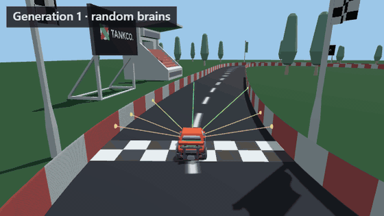
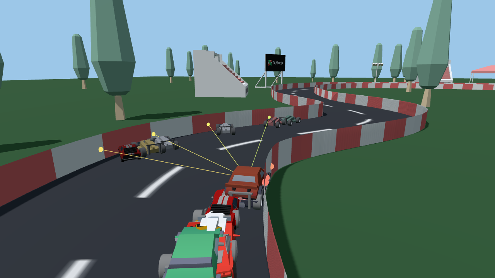
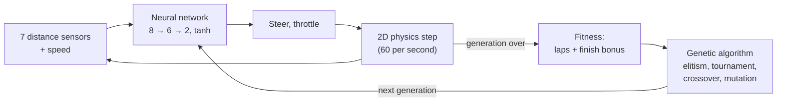

# NeuroDrive

[](https://github.com/omer-damar/Neurodrive/actions/workflows/ci.yml)


[](LICENSE)

**Self-driving cars that learn in your browser.** Each car is driven by a small neural network
that reads its distance sensors; a genetic algorithm breeds the best drivers into the next
generation. Everything is written by hand in plain JavaScript: no AI library, no framework, no
build step. The simulation is 2D; you can watch it in 2D or in 3D (Three.js).

**[▶ Open the live demo](https://omer-damar.github.io/Neurodrive/)** · [Türkçe](README.tr.md)



## Key results

Seven controlled experiments, each with 10 fixed seeds per condition and exact permutation tests;
the full write-up is in the **[experiment report](docs/REPORT.md)**.

| Question | Finding |
|---|---|
| Does the mutation rate matter? | Rates below 0.3 learn more slowly; from 0.3 up to 0.8 speed and final skill no longer change. |
| Do brains drive tracks they never saw? | Training on **three tracks in rotation** finishes 3.1 of 5 unseen tracks, against 0.7 for one track (p < 0.001). |
| Why do they still fail some? | Unseen corners sharper than any in training. One training track with such corners lifts the two failed tracks from **0/10 to 8/10 and 6/10** runs (p = 0.002). |
| How many sensors are needed? | 3 are too few, 5 are enough, and **9 generalize worse** than 5 or 7 (p < 0.001). |
| How robust are the brains to noisy sensors? | Robust up to ±0.1 noise; at ±0.2 most runs lose laps. Training with noise made no measurable difference. |
| Does a bigger network help or hurt? | Neither: 4 to 16 hidden neurons generalize and drive the same. Inputs and training matter, size does not. |
| Same budget: more cars or more generations? | The same tracks are passed either way, but **more generations drive faster** (24.62 vs 25.03 s, p < 0.001). |

## Features

- **Learning you can watch.** 100 cars per generation. The leader is followed by a chase camera,
  its network is drawn live, and a chart tracks best and average fitness per generation.
- **2D and 3D.** A 2D top view and a Three.js view with chase, top-down (mouse-wheel zoom) and free
  cameras, low-poly cars, barriers and trackside decor. Switching views never pauses training.
- **Track editor.** Draw your own closed track with the mouse or a finger; trained brains keep
  driving on it.
- **Brains.** Save the best brain in the browser, download or upload it as JSON, or start from the
  built-in pretrained brain, which laps all three preset tracks.
- **You vs AI.** Race the pretrained brain or your training's champion with the arrow keys or WASD
  (touch buttons on phones), choose one of six car models and chase your record on each track.
- **Experiments.** Seven controlled, statistically tested experiments with a full
  [report](docs/REPORT.md).
- **Turkish and English** interface.



## How it works



1. **Sensors.** Each car casts 7 rays over ±67.5°. A ray reads `1 − distance / range`
   (0 = clear, 1 = touching a wall); the car's speed is the 8th input.
2. **Network.** A feed-forward network `[8, 6, 2]` with `tanh` turns the inputs into steering and
   throttle. Weights are plain `Float64Array`s ([`neuralNetwork.js`](src/core/neuralNetwork.js)).
3. **Physics.** Deterministic 2D car physics with a fixed time step. Grip drops at high speed, so
   cars must learn to slow down before corners. A car is out when it hits a wall, gets stuck or
   turns back.
4. **Fitness.** Laps completed (as a fraction) plus a bonus for finishing three laps early.
5. **Evolution.** The two best brains survive unchanged; the rest are bred by tournament selection
   (k = 3), uniform crossover and Gaussian mutation (rate 0.1, strength 0.5).

All randomness comes from one seeded generator (`mulberry32`): the same seed and settings give the
same run, in the browser and in Node.

## Experiments

The experiments turn "the cars learn" into measured, reproducible claims. Every experiment trains
headlessly in Node with seeds 1–10 for each condition, changes exactly one variable, reports mean ±
standard deviation, and tests every comparison with an exact permutation test (Holm-corrected,
with Cliff's δ as effect size). Definitions and raw CSVs are in the repository, and one command
regenerates each chart and table.

**[Read the full experiment report →](docs/REPORT.md)** It explains the method and the statistics
in plain words and gives, for each experiment, why it matters, the hypothesis, the design, the
results, their interpretation and their limitations.

| # | Experiment | Result in one sentence |
|---|---|---|
| 1 | Mutation rate (0.05 → 0.8) | Mutate at least moderately (≥ 0.3); with elitism, more mutation costs nothing. |
| 2 | Generalization to five unseen tracks | Varied training tracks are what make a brain drive tracks it has never seen. |
| 3 | Sharp corners in training | A brain slows down for a corner only if it has met corners that sharp before. |
| 4 | Number of sensors (3 / 5 / 7 / 9) | Five sensors are enough; more can make generalization worse, not better. |
| 5 | Noisy sensors (±0 → ±0.2) | Brains tolerate moderate noise; training with noise made no measurable difference. |
| 6 | Network size (4 / 6 / 12 / 16 hidden) | The network's size does not matter for this task; its inputs and its training do. |
| 7 | Population vs generations (same budget) | Spend a fixed budget on generations: the same skills, driven faster. |

The two central results: rotating training generalizes far better than training on one track,
and the tracks it still fails become passable once a training track contains corners that sharp.





## Architecture

The simulation and the view are strictly separate. The simulation only produces 2D state
(`x, y, angle, …`); renderers read it and never change it.

```
src/core/          DOM-free logic; runs in the browser, in tests and in headless training
  track.js         spline tracks, walls, progress, validation
  car.js           physics, sensors, collision, laps
  neuralNetwork.js, genetics.js, simulation.js
  race.js          you-vs-AI race rules
  trackSketch.js   hand-drawn stroke → valid track
src/ui/            browser only
  main.js          app state and the fixed-step frame loop
  renderer2d.js    canvas 2D renderer
  three/           the only code that imports Three.js; loaded on first switch to 3D
  editor.js, race.js, chart.js, networkView.js, storage.js, i18n.js
scripts/           headless training, experiments and dependency-free SVG charts
tests/             node --test, no dependencies
```

- **One renderer interface:** `setTrack(track)`, `render(scene, view)`, `resize()`, `dispose()`.
  Training, the race and the editor all provide the same read-only scene `{ track, cars, leader }`.
- **One 2D → 3D mapping:** world `(x, y)` → Three.js `(x · 0.05, 0, y · 0.05)`.
- **Fixed time step:** the frame loop accumulates real time and runs whole physics steps, so speed
  does not depend on the screen's refresh rate; cars are interpolated between steps when drawn.
- **3D at scale:** every car model part is one `InstancedMesh`, so hundreds of cars cost a few draw
  calls; only the leader is a full model with steering front wheels. Without WebGL or the CDN, the
  app keeps working in 2D.

## Getting started

ES modules do not load from `file://`, so serve the folder and open <http://localhost:8000>:

```bash
python -m http.server 8000
```

`npx serve .` works too. The 3D view loads Three.js 0.160.0 from a CDN.

Run the tests (Node 22+, no dependencies):

```bash
npm test
```

Train headlessly; the champion brain is written to `trained/` as JSON and can be uploaded in the app:

```bash
npm run train -- --track classic --generations 80 --seed 42
```

Reproduce an experiment (4–10 minutes each; the [report](docs/REPORT.md#12-reproducing-the-results)
lists all nine):

```bash
npm run experiment -- experiments/generalization.json
```

The pretrained brain was produced with
`npm run train -- --tracks oval,classic,technical --generations 90 --seed 42 --pretrained`.

## Credits

**Car models (CC BY 3.0, attribution required)** from [Poly Pizza](https://poly.pizza), licensed
under [Creative Commons Attribution 3.0](https://creativecommons.org/licenses/by/3.0/). The files
are unmodified (renamed only); the app turns, rescales and tints them at runtime.

| Model | Author | Source |
|---|---|---|
| "Mazda RX-7" | IvOfficial | <https://poly.pizza/m/SnIoWlh7S2> |
| "Dodge Charger" | David Sirera | <https://poly.pizza/m/4b80hRVxqvv> |
| "Car" | theking1322 | <https://poly.pizza/m/t8njpnyrxg> |
| "Convertible" | Poly by Google | <https://poly.pizza/m/dggOiBLYyuR> |
| "Camaro ZL1 2017" | Kris Tong | <https://poly.pizza/m/7bF7UVAoYRG> |
| "CAR Model" | Ignition Labs | <https://poly.pizza/m/5zUWP5UsLg-> |

**Other models (CC0):** [Kenney](https://www.kenney.nl) [Car Kit](https://kenney.nl/assets/car-kit)
and [Racing Kit](https://kenney.nl/assets/racing-kit): race cars, grandstands, tents, trees, flags
and billboards. File list in [assets/models/LICENSE.md](assets/models/LICENSE.md).

**Library:** [Three.js](https://threejs.org) 0.160.0 (MIT), loaded from jsDelivr.

## License

Code: [MIT](LICENSE) © 2026 Ömer Faruk Damar. The 3D models keep their own licences (see Credits).
