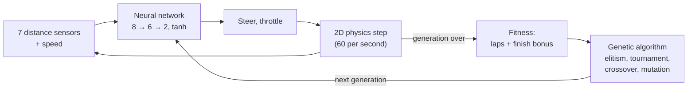

# NeuroDrive

[](https://github.com/omer-damar/neurodrive/actions/workflows/ci.yml)

**Self-driving cars that learn in your browser.** A hand-written neural network drives each car
from its distance sensors; a genetic algorithm breeds the best drivers into the next generation.
The simulation is 2D, the view is 2D or 3D (Three.js). No AI library, no build step.

**[▶ Live demo](https://omer-damar.github.io/neurodrive/)** · [Türkçe](README.tr.md)


## Features

- **Learning you can watch:** 100 cars per generation; the leader is followed by a chase camera,
  its network is drawn live and a chart shows best and average fitness per generation.
- **2D and 3D views:** a 2D top view and a Three.js view with chase, top-down (wheel zoom) and free
  cameras, low-poly cars, barriers and trackside decor. Switching views never stops training.
- **Track editor:** draw your own closed track with the mouse or a finger; the trained brains keep
  driving on it.
- **Brains:** save the best brain in the browser, download or upload it as JSON, or start from the
  built-in pretrained brain, which laps all three preset tracks.
- **You vs AI:** race the pretrained brain or your training's champion with the arrow keys / WASD
  (touch buttons on phones), pick one of six car models, beat your per-track record.
- **Experiments:** a headless trainer and an experiment runner reproduce results from the
  command line (see [Experiments](#experiments)).
- Turkish and English UI.


## How it works



1. **Sensors.** Each car casts 7 rays over ±67.5°. A ray reads `1 − distance / range`
   (0 = clear, 1 = touching a wall). The car's speed is the 8th input.
2. **Network.** A feed-forward network `[8, 6, 2]` with `tanh` turns the inputs into steering and
   throttle. Weights are plain `Float64Array`s, written by hand (`src/core/neuralNetwork.js`).
3. **Physics.** Simple, deterministic 2D car physics with a fixed time step. Grip drops at high
   speed, so cars learn to slow down before corners. A car dies when it hits a wall, gets stuck
   or turns back.
4. **Fitness.** Laps completed (as a fraction) plus a bonus for finishing three laps early.
5. **Evolution.** The two best brains are copied unchanged; the rest are bred by tournament
   selection (k = 3), uniform crossover and Gaussian mutation (rate 0.1, strength 0.5).

All randomness comes from one seeded generator (`mulberry32`), so a run with the same seed and
settings is identical every time, in the browser and in Node.

## Architecture

The simulation and the view are separate. The simulation only produces 2D state
(`x, y, angle, …`); renderers read it and never change it.

```
src/core/         DOM-free logic, runs in the browser and in Node
  track.js        spline tracks, walls, progress, validation
  car.js          physics, sensors, collision, laps
  neuralNetwork.js, genetics.js, simulation.js
  race.js         you-vs-AI race rules
  trackSketch.js  hand-drawn stroke -> valid track
src/ui/           browser only
  main.js         app state and the fixed-step frame loop
  renderer2d.js   canvas 2D renderer
  three/          the only code that imports Three.js, loaded on first switch to 3D
  editor.js, race.js, chart.js, networkView.js, storage.js, i18n.js
scripts/          headless training, experiments and plots
```

- **One renderer interface:** `setTrack(track)`, `render(scene, view)`, `resize()`, `dispose()`.
  The training, the race and the editor all provide the same read-only scene
  `{ track, cars, leader }`.
- **One 2D → 3D mapping:** world `(x, y)` → Three.js `(x · 0.05, 0, y · 0.05)`.
- **Fixed time step:** the frame loop accumulates real time and runs whole physics steps, so speed
  does not depend on the screen's refresh rate; cars are interpolated between steps when drawn.
- **3D at scale:** every car model part is one `InstancedMesh`, so 100–300 cars cost a few draw
  calls; only the leader is a full model with steering front wheels. If WebGL or the CDN is
  missing, the app keeps working in 2D.

## Experiments

**Does the mutation rate change how fast the cars learn?** Track `technical`, population 100,
50 generations, mutation rate ∈ {0.05, 0.1, 0.3}, 10 seeds (1–10) per condition; everything else at
its default. Values are mean ± sample standard deviation.



| Mutation rate | Generations to the first lap | Runs without a lap | Best lap (s) |
|---|---|---|---|
| 0.05 | 10.1 ± 4.6 | 0 / 10 | 8.75 ± 0.03 |
| 0.1 | 8.4 ± 4.2 | 0 / 10 | 8.74 ± 0.03 |
| 0.3 | 5.7 ± 2.2 | 0 / 10 | 8.73 ± 0.02 |

**Result.** In this range the highest rate learned fastest; the expected "middle is best" did not
show up. Final performance is the same in all conditions.
**Limitations.** Ten seeds, one track and three values: enough to see the trend, not for a strong
statistical claim. Higher rates (0.5, 0.8) would be needed to find where mutation starts to hurt.

Reproduce (about 5 minutes; same seeds give the same CSV):

```bash
npm run experiment -- experiments/mutation-rate.json
```

The definition is `experiments/mutation-rate.json`, the raw data `experiments/results/mutation-rate.csv`.

## Run locally

ES modules do not load from `file://`, so serve the folder:

```bash
python -m http.server 8000
```

Then open <http://localhost:8000>. `npx serve .` works too. The 3D view loads Three.js from a CDN.

## Tests and training

Tests use Node's built-in runner (Node 22+), no dependencies:

```bash
npm test
```

Train headlessly; the champion brain is written to `trained/` as JSON and can be uploaded in the app:

```bash
npm run train -- --track classic --generations 80 --seed 42
```

The pretrained brain in `src/core/pretrained.js` was produced with
`npm run train -- --tracks oval,classic,technical --generations 90 --seed 42 --pretrained`:
tracks rotate every generation and the elite that drives all three best is kept.

## Roadmap

- [x] 2D simulation, neural network and genetic algorithm
- [x] Headless training, experiments, GitHub Pages
- [x] 3D view, network and fitness charts, settings
- [x] Brain save/load and a pretrained brain
- [x] Track editor
- [x] You vs AI race mode
- [ ] Experiment 2: how well do brains generalize to tracks they never saw?

## Credits

**Car models (CC BY 3.0, attribution required)**, from [Poly Pizza](https://poly.pizza), licensed
under [Creative Commons Attribution 3.0](https://creativecommons.org/licenses/by/3.0/). The files
are unmodified (renamed only); the app turns, rescales and tints them at runtime.

| Model | Author | Source |
|---|---|---|
| "Mazda RX-7" | IvOfficial | <https://poly.pizza/m/SnIoWlh7S2> |
| "Dodge Charger" | David Sirera | <https://poly.pizza/m/4b80hRVxqvv> |
| "Car" | theking1322 | <https://poly.pizza/m/t8njpnyrxg> |
| "Convertible" | Poly by Google | <https://poly.pizza/m/dggOiBLYyuR> |
| "Camaro ZL1 2017" | Kris Tong | <https://poly.pizza/m/7bF7UVAoYRG> |
| "CAR Model" | Ignition Labs | <https://poly.pizza/m/5zUWP5UsLg-> |

**Other models (CC0):** [Kenney](https://www.kenney.nl) [Car Kit](https://kenney.nl/assets/car-kit)
and [Racing Kit](https://kenney.nl/assets/racing-kit): race cars, grandstands, tents, trees, flags
and billboards. See [assets/models/LICENSE.md](assets/models/LICENSE.md) for the file list.

**Library:** [Three.js](https://threejs.org) 0.160.0 (MIT), loaded from jsDelivr.

## License

Code: [MIT](LICENSE) © 2026 Ömer Faruk Damar. The 3D models keep their own licences (above).
