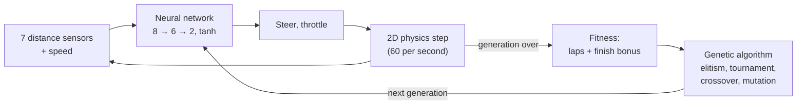

# NeuroDrive

[](https://github.com/omer-damar/Neurodrive/actions/workflows/ci.yml)


[](LICENSE)

**Self-driving cars that learn in your browser.** Each car is driven by a small neural network
that reads its distance sensors; a genetic algorithm breeds the best drivers into the next
generation. Everything is written by hand in plain JavaScript: no AI library, no framework, no
build step. The simulation is 2D; you can watch it in 2D or in 3D (Three.js).

**[▶ Open the live demo](https://omer-damar.github.io/Neurodrive/)** · [Türkçe](README.tr.md)


## Key results

Measured headlessly over 10 fixed seeds per condition (mean ± standard deviation); every number
below is reproducible with one command ([Experiments](#experiments)).

| Question | Finding |
|---|---|
| How fast do cars learn? | On the hardest preset, the best car completes its first lap after **5.7–10.1 generations** and reaches the same lap time (≈ 8.7 s) whatever the mutation rate. |
| Do brains drive tracks they never saw? | Training on **one** track: 0.7 of 5 unseen tracks finished. Training on **three tracks in rotation**: 3.1 of 5, in every run. |
| Why do they still fail some tracks? | Unseen corners sharper than any training corner. Adding **one track with such corners** to training raises the two failed tracks from 0/10 to **8/10 and 6/10** runs. |

## Features

- **Learning you can watch.** 100 cars per generation. The leader is followed by a chase camera,
  its network is drawn live, and a chart tracks best and average fitness per generation.
- **2D and 3D.** A 2D top view and a Three.js view with chase, top-down (mouse-wheel zoom) and free
  cameras, low-poly cars, barriers and trackside decor. Switching views never pauses training.
- **Track editor.** Draw your own closed track with the mouse or a finger; trained brains keep
  driving on it.
- **Brains.** Save the best brain in the browser, download or upload it as JSON, or start from the
  built-in pretrained brain, which laps all three preset tracks.
- **You vs AI.** Race the pretrained brain or your training's champion with the arrow keys or WASD
  (touch buttons on phones), choose one of six car models and chase your record on each track.
- **Turkish and English** interface.


## How it works



1. **Sensors.** Each car casts 7 rays over ±67.5°. A ray reads `1 − distance / range`
   (0 = clear, 1 = touching a wall); the car's speed is the 8th input.
2. **Network.** A feed-forward network `[8, 6, 2]` with `tanh` turns the inputs into steering and
   throttle. Weights are plain `Float64Array`s ([`neuralNetwork.js`](src/core/neuralNetwork.js)).
3. **Physics.** Deterministic 2D car physics with a fixed time step. Grip drops at high speed, so
   cars must learn to slow down before corners. A car is out when it hits a wall, gets stuck or
   turns back.
4. **Fitness.** Laps completed (as a fraction) plus a bonus for finishing three laps early.
5. **Evolution.** The two best brains survive unchanged; the rest are bred by tournament selection
   (k = 3), uniform crossover and Gaussian mutation (rate 0.1, strength 0.5).

All randomness comes from one seeded generator (`mulberry32`): the same seed and settings give the
same run, in the browser and in Node.

## Experiments

**Method, shared by all experiments.** Training runs headlessly in Node. Only the variable under
study changes; everything else stays at its default. Each condition runs with seeds 1–10, and
results are reported as mean ± sample standard deviation. Definitions (`experiments/*.json`) and
raw CSVs are in the repository; the same command regenerates the same CSV, chart and table.

### 1. Does the mutation rate change how fast cars learn?

**Setup.** Track `technical` (the hardest preset), population 100, 50 generations, mutation rate
∈ {0.05, 0.1, 0.3}.


| Mutation rate | Generations to the first lap | Runs without a lap | Best lap (s) |
|---|---|---|---|
| 0.05 | 10.1 ± 4.6 | 0 / 10 | 8.75 ± 0.03 |
| 0.1 | 8.4 ± 4.2 | 0 / 10 | 8.74 ± 0.03 |
| 0.3 | 5.7 ± 2.2 | 0 / 10 | 8.73 ± 0.02 |

**Takeaway.** Within this range the highest rate learned fastest; the expected "middle rate is
best" did not appear. Final performance is the same in every condition.
**Limitations.** One track and three values; higher rates (0.5, 0.8) would be needed to find where
mutation starts to hurt.

### 2. Do brains drive tracks they have never seen?

**Setup.** Two conditions with the same budget (60 generations, population 100): train on one track
(`classic`), or on the three presets in rotation (the track changes every generation). Each run's
champion is chosen on its own training tracks only, then drives five **new tracks that no
condition trained on**, once, without learning.


| Training | Laps per unseen track (of 3) | Unseen tracks finished (of 5) | Laps on training tracks |
|---|---|---|---|
| One track (`classic`) | 0.44 ± 0.67 | 0.7 ± 1.1 | 3.00 ± 0.00 |
| Rotating (oval, classic, technical) | 1.86 ± 0.19 | 3.1 ± 0.3 | 3.00 ± 0.00 |

**Takeaway.** Both conditions master their own tracks, but rotating training generalizes far
better and far more consistently: it finished `square`, `snake` and `bean` in 10 of 10 runs
(one-track training: 3, 2 and 2). `triangle` and `horseshoe` were almost never passed, by any brain
including the pretrained one. Every brain crashes at the same spot: the sharpest corner, entered at
full speed. Those corners turn harder than any corner in the training tracks (1.76 and −2.17 rad
over a ≈ 480-unit arc, against at most 1.67 and −1.38).
**Limitations.** The test tracks are hand-designed (checked only to be valid and drivable, not
tuned to either condition). Rotating training sees both more tracks and more varied corners; this
experiment alone cannot tell which matters. Experiment 2b separates the two.

### 2b. Is it the sharp corners?

**Setup.** Both conditions train on **four** tracks in rotation: the three presets plus one new
track. The number of tracks is equal; only the fourth track's corners differ. *Mild* adds a track
whose corners stay within the presets' range. *Sharp* adds a track whose hardest corners match the
two failed test tracks (1.73 and −2.18 rad; the track validator allows nothing sharper). Same five
unseen tracks, 60 generations.


| Fourth training track | Laps per unseen track (of 3) | Unseen tracks finished (of 5) | `triangle` finished | `horseshoe` finished |
|---|---|---|---|---|
| Mild corners | 1.80 ± 0.00 | 3.0 ± 0.0 | 0 / 10 | 0 / 10 |
| Sharp corners | 2.54 ± 0.68 | 4.2 ± 1.2 | 8 / 10 | 6 / 10 |

**Takeaway.** The corner explanation holds. A mild fourth track changes nothing; a sharp one lets
brains pass the triangle in 8 of 10 runs and the horseshoe in 6 of 10, while the easier tracks are
still finished in nearly every run. A brain learns to slow down for a corner only if it has met
corners that sharp in training.
**Limitations.** One sharp-condition run (seed 4) never found a brain that drives all four of its
own training tracks and did poorly on the test tracks too: the sharp track makes training harder,
hence the larger spread. The sharp track was built to match the failed corners, so the result says
that such corners must be seen in training, not that any sharp track would do.

## Architecture

The simulation and the view are strictly separate. The simulation only produces 2D state
(`x, y, angle, …`); renderers read it and never change it.

```
src/core/          DOM-free logic; runs in the browser, in tests and in headless training
  track.js         spline tracks, walls, progress, validation
  car.js           physics, sensors, collision, laps
  neuralNetwork.js, genetics.js, simulation.js
  race.js          you-vs-AI race rules
  trackSketch.js   hand-drawn stroke → valid track
src/ui/            browser only
  main.js          app state and the fixed-step frame loop
  renderer2d.js    canvas 2D renderer
  three/           the only code that imports Three.js; loaded on first switch to 3D
  editor.js, race.js, chart.js, networkView.js, storage.js, i18n.js
scripts/           headless training, experiments and dependency-free SVG charts
tests/             node --test, no dependencies
```

- **One renderer interface:** `setTrack(track)`, `render(scene, view)`, `resize()`, `dispose()`.
  Training, the race and the editor all provide the same read-only scene `{ track, cars, leader }`.
- **One 2D → 3D mapping:** world `(x, y)` → Three.js `(x · 0.05, 0, y · 0.05)`.
- **Fixed time step:** the frame loop accumulates real time and runs whole physics steps, so speed
  does not depend on the screen's refresh rate; cars are interpolated between steps when drawn.
- **3D at scale:** every car model part is one `InstancedMesh`, so hundreds of cars cost a few draw
  calls; only the leader is a full model with steering front wheels. Without WebGL or the CDN, the
  app keeps working in 2D.

## Getting started

ES modules do not load from `file://`, so serve the folder and open <http://localhost:8000>:

```bash
python -m http.server 8000
```

`npx serve .` works too. The 3D view loads Three.js 0.160.0 from a CDN.

Run the tests (Node 22+, no dependencies):

```bash
npm test
```

Train headlessly; the champion brain is written to `trained/` as JSON and can be uploaded in the app:

```bash
npm run train -- --track classic --generations 80 --seed 42
```

Reproduce the experiments (about 4–5 minutes each):

```bash
npm run experiment -- experiments/mutation-rate.json
```

```bash
npm run experiment -- experiments/generalization.json
```

```bash
npm run experiment -- experiments/generalization-corners.json
```

The pretrained brain was produced with
`npm run train -- --tracks oval,classic,technical --generations 90 --seed 42 --pretrained`.

## Credits

**Car models (CC BY 3.0, attribution required)** from [Poly Pizza](https://poly.pizza), licensed
under [Creative Commons Attribution 3.0](https://creativecommons.org/licenses/by/3.0/). The files
are unmodified (renamed only); the app turns, rescales and tints them at runtime.

| Model | Author | Source |
|---|---|---|
| "Mazda RX-7" | IvOfficial | <https://poly.pizza/m/SnIoWlh7S2> |
| "Dodge Charger" | David Sirera | <https://poly.pizza/m/4b80hRVxqvv> |
| "Car" | theking1322 | <https://poly.pizza/m/t8njpnyrxg> |
| "Convertible" | Poly by Google | <https://poly.pizza/m/dggOiBLYyuR> |
| "Camaro ZL1 2017" | Kris Tong | <https://poly.pizza/m/7bF7UVAoYRG> |
| "CAR Model" | Ignition Labs | <https://poly.pizza/m/5zUWP5UsLg-> |

**Other models (CC0):** [Kenney](https://www.kenney.nl) [Car Kit](https://kenney.nl/assets/car-kit)
and [Racing Kit](https://kenney.nl/assets/racing-kit): race cars, grandstands, tents, trees, flags
and billboards. File list in [assets/models/LICENSE.md](assets/models/LICENSE.md).

**Library:** [Three.js](https://threejs.org) 0.160.0 (MIT), loaded from jsDelivr.

## License

Code: [MIT](LICENSE) © 2026 Ömer Faruk Damar. The 3D models keep their own licences (see Credits).
