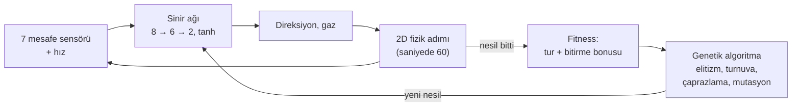

# NeuroDrive

[](https://github.com/omer-damar/neurodrive/actions/workflows/ci.yml)

**Tarayıcıda kendi kendine sürmeyi öğrenen arabalar.** Her arabayı mesafe sensörlerinden beslenen,
elle yazılmış bir sinir ağı sürer; genetik algoritma en iyi sürücüleri bir sonraki nesle aktarır.
Simülasyon 2D, görüntü 2D ya da 3D (Three.js). Yapay zekâ kütüphanesi ve derleme adımı yok.

**[▶ Canlı demo](https://omer-damar.github.io/neurodrive/)** · [English](README.md)


## Özellikler

- **İzlenebilir öğrenme:** her nesilde 100 araba; lideri takip kamerası izler, liderin sinir ağı
  canlı çizilir, grafik nesil başına en iyi ve ortalama fitness'ı gösterir.
- **2D ve 3D görünüm:** 2D üstten görünüm ve takip, üstten (tekerlekle yakınlaştırma) ve serbest
  kameralı Three.js görünümü; low-poly arabalar, bariyerler ve pist kenarı dekoru. Görünüm
  değiştirmek eğitimi durdurmaz.
- **Pist editörü:** fareyle ya da parmakla kendi kapalı pistini çiz; eğitilmiş beyinler yeni pistte
  sürmeye devam eder.
- **Beyinler:** en iyi beyni tarayıcıya kaydet, JSON olarak indir ya da yükle veya üç hazır pistin
  hepsinde tur atan gömülü hazır beyinle başla.
- **Sen vs YZ:** hazır beyinle ya da eğitimin şampiyonuyla ok tuşları / WASD ile yarış (telefonda
  dokunmatik düğmeler), altı araba modelinden birini seç, pist rekorunu kır.
- **Deneyler:** headless eğitim ve deney betikleri sonuçları komut satırından yeniden üretir
  (bkz. [Deneyler](#deneyler)).
- Türkçe ve İngilizce arayüz.


## Nasıl çalışır



1. **Sensörler.** Her araba ±67,5° aralığında 7 ışın gönderir. Işın değeri `1 − mesafe / menzil`
   (0 = boş, 1 = duvara değiyor). Arabanın hızı 8. girdidir.
2. **Ağ.** `tanh` aktivasyonlu `[8, 6, 2]` ileri beslemeli ağ, girdileri direksiyon ve gaza
   çevirir. Ağırlıklar düz `Float64Array`'lerdir ve elle yazılmıştır (`src/core/neuralNetwork.js`).
3. **Fizik.** Sabit zaman adımlı, basit ve deterministik 2D araba fiziği. Yüksek hızda yol tutuş
   azalır, bu yüzden arabalar virajdan önce yavaşlamayı öğrenir. Duvara çarpan, takılan ya da geri
   dönen araba elenir.
4. **Fitness.** Tamamlanan tur oranı ve üç turu erken bitirene bonus.
5. **Evrim.** En iyi iki beyin olduğu gibi kopyalanır; geri kalanlar turnuva seçimi (k = 3),
   uniform çaprazlama ve Gauss mutasyonuyla (oran 0,1, şiddet 0,5) üretilir.

Tüm rastgelelik tek bir tohumlu üreteçten (`mulberry32`) gelir; aynı tohum ve ayarlarla yapılan
koşu tarayıcıda da Node'da da her seferinde aynıdır.

## Mimari

Simülasyon ve görüntü ayrıdır. Simülasyon yalnızca 2D durum (`x, y, angle, …`) üretir; çiziciler
bu durumu okur, asla değiştirmez.

```
src/core/         DOM'suz mantık, tarayıcıda ve Node'da çalışır
  track.js        spline pistler, duvarlar, ilerleme, doğrulama
  car.js          fizik, sensörler, çarpışma, turlar
  neuralNetwork.js, genetics.js, simulation.js
  race.js         sen vs YZ yarış kuralları
  trackSketch.js  elle çizilen iz -> geçerli pist
src/ui/           yalnızca tarayıcı
  main.js         uygulama durumu ve sabit adımlı kare döngüsü
  renderer2d.js   canvas 2D çizici
  three/          Three.js'i import eden tek kod, 3D'ye ilk geçişte yüklenir
  editor.js, race.js, chart.js, networkView.js, storage.js, i18n.js
scripts/          headless eğitim, deneyler ve grafikler
```

- **Tek çizici arayüzü:** `setTrack(track)`, `render(scene, view)`, `resize()`, `dispose()`.
  Eğitim, yarış ve editör aynı salt-okunur sahneyi sağlar: `{ track, cars, leader }`.
- **Tek 2D → 3D eşlemesi:** dünya `(x, y)` → Three.js `(x · 0,05, 0, y · 0,05)`.
- **Sabit zaman adımı:** kare döngüsü gerçek süreyi biriktirip tam fizik adımları atar; hız ekranın
  yenileme hızına bağlı değildir. Arabalar çizilirken iki adım arasında ara değerlenir.
- **Ölçekte 3D:** her araba modeli parçası tek bir `InstancedMesh`'tir; 100–300 araba birkaç çizim
  çağrısına mal olur. Yalnızca lider, dönen ön tekerlekleriyle tam modeldir. WebGL ya da CDN yoksa
  uygulama 2D'de çalışmaya devam eder.

## Deneyler

**Mutasyon oranı öğrenme hızını değiştiriyor mu?** Pist `technical`, nüfus 100, 50 nesil, mutasyon
oranı ∈ {0,05, 0,1, 0,3}, koşul başına 10 tohum (1–10); geri kalan her şey varsayılanında. Değerler
ortalama ± örneklem standart sapması.


| Mutasyon oranı | İlk tura kadar nesil | Hiç tur atamayan koşu | En iyi tur (sn) |
|---|---|---|---|
| 0,05 | 10,1 ± 4,6 | 0 / 10 | 8,75 ± 0,03 |
| 0,1 | 8,4 ± 4,2 | 0 / 10 | 8,74 ± 0,03 |
| 0,3 | 5,7 ± 2,2 | 0 / 10 | 8,73 ± 0,02 |

**Sonuç.** Bu aralıkta en yüksek oran en hızlı öğrendi; beklenen "orta değer en iyisi" görülmedi.
Son performans tüm koşullarda aynı.
**Sınırlılıklar.** On tohum, tek pist ve üç değer: eğilimi görmeye yeter, güçlü bir istatistiksel
iddiaya yetmez. Mutasyonun zarar vermeye başladığı eşiği bulmak için daha yüksek oranlar (0,5, 0,8)
denenmeli.

Yeniden üretmek için (yaklaşık 5 dakika; aynı tohumlar aynı CSV'yi verir):

```bash
npm run experiment -- experiments/mutation-rate.json
```

Tanım `experiments/mutation-rate.json`, ham veri `experiments/results/mutation-rate.csv` dosyasında.

## Yerelde çalıştırma

ES modülleri `file://` üzerinden yüklenmez; klasörü bir sunucuyla aç:

```bash
python -m http.server 8000
```

Ardından <http://localhost:8000> adresini aç. `npx serve .` da çalışır. 3D görünüm Three.js'i
CDN'den yükler.

## Testler ve eğitim

Testler Node'un yerleşik koşucusunu kullanır (Node 22+), bağımlılık yok:

```bash
npm test
```

Headless eğitim; şampiyon beyin `trained/` klasörüne JSON olarak yazılır ve uygulamada yüklenebilir:

```bash
npm run train -- --track classic --generations 80 --seed 42
```

`src/core/pretrained.js` içindeki hazır beyin
`npm run train -- --tracks oval,classic,technical --generations 90 --seed 42 --pretrained` ile
üretildi: pist her nesil değişir ve üç pisti birden en iyi süren elit saklanır.

## Yol haritası

- [x] 2D simülasyon, sinir ağı ve genetik algoritma
- [x] Headless eğitim, deneyler, GitHub Pages
- [x] 3D görünüm, ağ ve fitness grafikleri, ayarlar
- [x] Beyin kaydet/yükle ve hazır beyin
- [x] Pist editörü
- [x] Sen vs YZ yarış modu
- [ ] Deney 2: beyinler hiç görmedikleri pistlere ne kadar genelleniyor?

## Credits

**Araba modelleri (CC BY 3.0, atıf zorunlu)**, [Poly Pizza](https://poly.pizza)'dan,
[Creative Commons Attribution 3.0](https://creativecommons.org/licenses/by/3.0/) lisansıyla.
Dosyalar değiştirilmedi (yalnızca yeniden adlandırıldı); uygulama onları çalışırken döndürür,
ölçekler ve renklendirir.

| Model | Yazar | Kaynak |
|---|---|---|
| "Mazda RX-7" | IvOfficial | <https://poly.pizza/m/SnIoWlh7S2> |
| "Dodge Charger" | David Sirera | <https://poly.pizza/m/4b80hRVxqvv> |
| "Car" | theking1322 | <https://poly.pizza/m/t8njpnyrxg> |
| "Convertible" | Poly by Google | <https://poly.pizza/m/dggOiBLYyuR> |
| "Camaro ZL1 2017" | Kris Tong | <https://poly.pizza/m/7bF7UVAoYRG> |
| "CAR Model" | Ignition Labs | <https://poly.pizza/m/5zUWP5UsLg-> |

**Diğer modeller (CC0):** [Kenney](https://www.kenney.nl) [Car Kit](https://kenney.nl/assets/car-kit)
ve [Racing Kit](https://kenney.nl/assets/racing-kit): yarış arabaları, tribünler, çadırlar,
ağaçlar, bayraklar ve panolar. Dosya listesi için
[assets/models/LICENSE.md](assets/models/LICENSE.md).

**Kütüphane:** [Three.js](https://threejs.org) 0.160.0 (MIT), jsDelivr'den yüklenir.

## Lisans

Kod: [MIT](LICENSE) © 2026 Ömer Faruk Damar. 3D modeller kendi lisanslarını korur (yukarıda).
