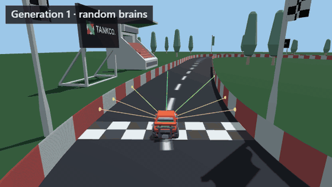
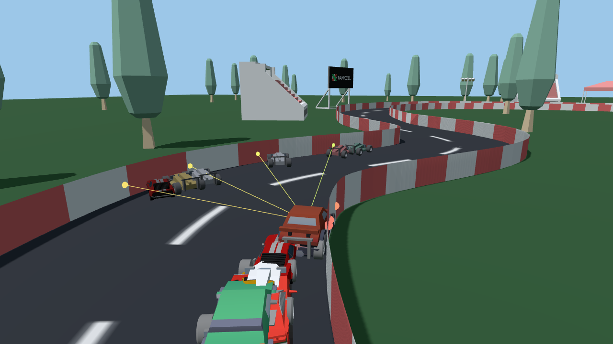
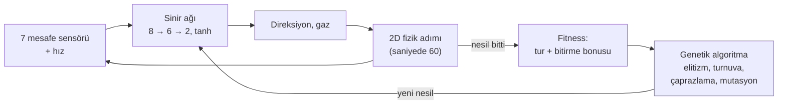

# NeuroDrive

[](https://github.com/omer-damar/Neurodrive/actions/workflows/ci.yml)


[](LICENSE)

**Tarayıcıda kendi kendine sürmeyi öğrenen arabalar.** Her arabayı, mesafe sensörlerini okuyan
küçük bir sinir ağı sürer; genetik algoritma en iyi sürücüleri bir sonraki nesle aktarır. Her şey
düz JavaScript ile elle yazıldı: yapay zekâ kütüphanesi, framework ve derleme adımı yok.
Simülasyon 2D; 2D ya da 3D (Three.js) izlenebilir.

**[▶ Canlı demoyu aç](https://omer-damar.github.io/Neurodrive/)** · [English](README.md)



## Öne çıkan sonuçlar

Dokuz kontrollü deney; her koşulda 10 sabit tohum ve kesin permütasyon testleri. Ayrıntılı anlatım
**[deney raporunda](docs/REPORT.tr.md)**.

| Soru | Bulgu |
|---|---|
| Mutasyon oranı önemli mi? | 0,3'ün altındaki oranlar daha yavaş öğreniyor; 0,3'ten 0,8'e kadar hız ve son beceri artık değişmiyor. |
| Beyinler hiç görmedikleri pistleri sürebiliyor mu? | **Üç pistte dönüşümlü** eğitim 5 görülmemiş pistin 3,1'ini bitiriyor, tek pist eğitimi 0,7'sini (p < 0,001). |
| Bazılarında neden hâlâ başarısızlar? | Eğitimdeki her virajdan keskin görülmemiş virajlar. Böyle virajlı tek bir eğitim pisti, geçilemeyen iki pisti **0/10'dan 8/10 ve 6/10** koşuya çıkarıyor (p = 0,002). |
| Kaç sensör gerekli? | 3 az, 5 yeterli; aynı yelpazeye sıkıştırılmış **9 ışın daha kötü genelleniyor** (p < 0,001). |
| Beyinler gürültülü sensörlere ne kadar dayanıklı? | ±0,1 gürültüye kadar dayanıklı; ±0,2'de çoğu koşu tur kaybediyor. Gürültüyle eğitmek ölçülebilir bir fark yaratmadı. |
| Büyük bir ağ yardım mı ediyor, zarar mı veriyor? | İkisi de değil: 4'ten 16'ya gizli nöron aynı genelleniyor ve aynı sürüyor. Önemli olan girdiler ve eğitim, büyüklük değil. |
| Aynı bütçe: daha çok araba mı, daha çok nesil mi? | Her iki yolda da aynı pistler geçiliyor, ama **daha çok nesil daha hızlı sürüyor** (24,62'ye karşı 25,03 sn, p < 0,001). |
| 9 sensör neden daha kötü genelleniyor? | Sayıları değil **aralıkları**: 22,5°'den sık dizilmiş ışınlar zarar veriyor, daha geniş yayılmış 9 ışın sorunsuz (p ≤ 0,010). |
| Kaç eğitim pisti gerekli? | İkincisi daha zor virajlı olmak şartıyla iki; daha fazla kolay pist hiçbir şey eklemiyor (p = 1,000). |

## Özellikler

- **İzlenebilir öğrenme.** Her nesilde 100 araba. Lideri takip kamerası izler, liderin sinir ağı
  canlı çizilir, bir grafik nesil başına en iyi ve ortalama fitness'ı gösterir.
- **2D ve 3D.** 2D üstten görünüm ve takip, üstten (fare tekerleğiyle yakınlaştırma) ve serbest
  kameralı Three.js görünümü; low-poly arabalar, bariyerler ve pist kenarı dekoru. Görünüm
  değiştirmek eğitimi durdurmaz.
- **Pist editörü.** Fareyle ya da parmakla kendi kapalı pistini çiz; eğitilmiş beyinler yeni pistte
  sürmeye devam eder.
- **Beyinler.** En iyi beyni tarayıcıya kaydet, JSON olarak indir ya da yükle veya üç hazır pistin
  hepsinde tur atan gömülü hazır beyinle başla.
- **Sen vs YZ.** Hazır beyinle ya da eğitimin şampiyonuyla ok tuşları veya WASD ile yarış
  (telefonda dokunmatik düğmeler), altı araba modelinden birini seç, her pistteki rekorunu kovala.
- **Deneyler.** İstatistiksel olarak sınanmış dokuz kontrollü deney ve ayrıntılı bir
  [rapor](docs/REPORT.tr.md).
- **Türkçe ve İngilizce** arayüz.



## Nasıl çalışır



1. **Sensörler.** Her araba ±67,5° aralığında 7 ışın gönderir. Işın değeri `1 − mesafe / menzil`
   (0 = boş, 1 = duvara değiyor); arabanın hızı 8. girdidir.
2. **Ağ.** `tanh` aktivasyonlu `[8, 6, 2]` ileri beslemeli ağ, girdileri direksiyon ve gaza
   çevirir. Ağırlıklar düz `Float64Array`'lerdir ([`neuralNetwork.js`](src/core/neuralNetwork.js)).
3. **Fizik.** Sabit zaman adımlı, deterministik 2D araba fiziği. Yüksek hızda yol tutuş azalır;
   arabalar virajdan önce yavaşlamayı öğrenmek zorundadır. Duvara çarpan, takılan ya da geri dönen
   araba elenir.
4. **Fitness.** Tamamlanan tur oranı ve üç turu erken bitirene bonus.
5. **Evrim.** En iyi iki beyin olduğu gibi kalır; geri kalanlar turnuva seçimi (k = 3), uniform
   çaprazlama ve Gauss mutasyonuyla (oran 0,1, şiddet 0,5) üretilir.

Tüm rastgelelik tek bir tohumlu üreteçten (`mulberry32`) gelir: aynı tohum ve ayarlar, tarayıcıda da
Node'da da aynı koşuyu verir.

## Deneyler

Deneyler "arabalar öğreniyor" iddiasını ölçülmüş, tekrar üretilebilir iddialara dönüştürüyor. Her
deney Node'da ekransız eğitilir, her koşulda 1–10 tohumlarını kullanır, yalnızca tek bir değişkeni
değiştirir, ortalama ± standart sapma verir ve her karşılaştırmayı kesin bir permütasyon testiyle
sınar (Holm düzeltmeli, etki büyüklüğü olarak Cliff's δ ile). Tanımlar ve ham CSV'ler repoda; tek
bir komut her grafiği ve tabloyu yeniden üretir.

**[Ayrıntılı deney raporunu oku →](docs/REPORT.tr.md)** Rapor, yöntemi ve istatistikleri sade bir
dille açıklıyor; her deney için neden önemli olduğunu, hipotezi, tasarımı, sonuçları, yorumu ve
sınırlılıkları veriyor.

### Deneyler ne gösterdi?

Sonuçlar kanıt gücüne göre gruplandı. *p*, Holm düzeltmeli permütasyon testi; δ, Cliff'in etki
büyüklüğü (|δ| ≥ 0,474 büyük). Köşeli parantezdeki sayılar rapordaki deney numaraları.

**✅ Anlamlı ve büyük etkiyle gösterilenler**

| Bulgu | Kanıt |
|---|---|
| Genellemeyi **çeşitli eğitim** sağlıyor: tek pist 5 görülmemiş pistin 0,7'sini, dönüşümlü üç pist 3,1'ini bitiriyor [2] | p < 0,001, δ = −0,91 |
| Beyinler **eğitimde gördüklerinden keskin** virajlarda kalıyor; böyle virajlı tek bir eğitim pisti, geçilemeyen pistleri 0/10'dan 8/10 ve 6/10 koşuya çıkarıyor [3] | p = 0,002, δ = −0,80 |
| **Genellemenin bir bedeli var**: keskin virajla eğitilen beyinler sıradan bir pisti çok daha yavaş sürüyor, 31,5'e karşı 25,2 sn [3] | p < 0,001, δ = −1,00 |
| Önemli olan pistlerin **sayısı değil, hangileri olduğu**: daha keskin virajlı ikinci pist kazancın tamamını veriyor, üçüncü ve dördüncü kolay pist hiçbir şey eklemiyor [9] | 1 vs 2 pist p < 0,001; 2 vs 3 vs 4 p = 1,000 |
| **3 sensör az**: koşuların 3/10'u hiç tur atamıyor, kalanlar yaklaşık üç kat fazla nesle ihtiyaç duyuyor; 5 yeterli [4] | p < 0,001, δ ≥ 0,94 |
| Genellemeyi ışın sayısı değil **ışın aralığı** belirliyor: 22,5°'den sık dizilmiş ışınlar 7 de olsa 9 da olsa zarar veriyor; daha geniş yayılmış 9 ışın sorunsuz [4, 8] | p ≤ 0,010, δ ≥ 0,73 |
| Bütçe sabitken **daha çok nesil daha hızlı sürüyor** (24,62'ye karşı 25,03 sn); geçilen pistler aynı kalıyor [7] | p < 0,001, δ = −1,00 |
| **Çok düşük mutasyon oranı** (0,05), 0,3'ten yavaş öğreniyor [1] | p = 0,044, δ = 0,61 |

**❌ Deneylerin çürüttüğü hipotezler**

- *"Orta düzey mutasyon oranı en iyisidir."* 0,3'ten 0,8'e kadar hiçbir şey değişmiyor; muhtemelen
  elitizm en iyi beyni hep bozulmadan sakladığı için [1].
- *"9 sensör, ağ aşırı uyum yaptığı için kötü genelleniyor."* İki kat fazla ağırlığı olan 16 nöronlu
  ağ varsayılan ağ gibi genelleniyor; sebebin ışın aralığı olduğu ortaya çıktı [6, 8].
- *"Daha çok eğitim pisti her zaman daha iyidir."* Önemli olan yalnızca eklenen pistin içeriği [9].
- *"Daha büyük bir ağ genellemeyi değiştirir."* 4 ile 16 gizli nöron birebir aynı davranıyor [6].

**〰️ 10 koşuyla gösterilemeyen eğilimler**

- Güçlü sensör gürültüsü (±0,2), 10 koşunun 6'sında performansı düşürüyor, hiçbirinde artırmıyor;
  ama düzeltme sonrası p = 0,19 [5].
- Gürültülü sensörlerle eğitmek, gürültü altında biraz daha iyi sayılar veriyor; anlamlılıktan çok
  uzak [5].

**Büyük resim.** Bir beynin neler yapabileceğini; ne kadar büyük olduğu, kaç sensörü olduğu ya da
ağırlıklarının ne kadar mutasyona uğradığı değil, **eğitimde neyle karşılaştığı** belirliyor. Bu,
makine öğrenmesinin temel dersi; burada sıfırdan yazılmış bir sistemde ölçüldü.

İki merkezî grafik: dönüşümlü eğitim tek pistte eğitimden çok daha iyi genelleniyor ve hâlâ
geçemediği pistler, eğitim pistlerinden biri o keskinlikte virajlar içerince geçilebilir hale
geliyor.





## Mimari

Simülasyon ve görüntü kesin olarak ayrıdır. Simülasyon yalnızca 2D durum (`x, y, angle, …`) üretir;
çiziciler bu durumu okur, asla değiştirmez.

```
src/core/          DOM'suz mantık; tarayıcıda, testlerde ve ekransız eğitimde çalışır
  track.js         spline pistler, duvarlar, ilerleme, doğrulama
  car.js           fizik, sensörler, çarpışma, turlar
  neuralNetwork.js, genetics.js, simulation.js
  race.js          sen vs YZ yarış kuralları
  trackSketch.js   elle çizilen iz → geçerli pist
src/ui/            yalnızca tarayıcı
  main.js          uygulama durumu ve sabit adımlı kare döngüsü
  renderer2d.js    canvas 2D çizici
  three/           Three.js'i import eden tek kod; 3D'ye ilk geçişte yüklenir
  editor.js, race.js, chart.js, networkView.js, storage.js, i18n.js
scripts/           ekransız eğitim, deneyler ve bağımlılıksız SVG grafikler
tests/             node --test, bağımlılık yok
```

- **Tek çizici arayüzü:** `setTrack(track)`, `render(scene, view)`, `resize()`, `dispose()`.
  Eğitim, yarış ve editör aynı salt-okunur sahneyi sağlar: `{ track, cars, leader }`.
- **Tek 2D → 3D eşlemesi:** dünya `(x, y)` → Three.js `(x · 0,05, 0, y · 0,05)`.
- **Sabit zaman adımı:** kare döngüsü gerçek süreyi biriktirip tam fizik adımları atar; hız ekranın
  yenileme hızına bağlı değildir. Arabalar çizilirken iki adım arasında ara değerlenir.
- **Ölçekte 3D:** her araba modeli parçası tek bir `InstancedMesh`; yüzlerce araba birkaç çizim
  çağrısına mal olur. Yalnızca lider, dönen ön tekerlekleriyle tam modeldir. WebGL ya da CDN yoksa
  uygulama 2D'de çalışmaya devam eder.

## Başlarken

ES modülleri `file://` üzerinden yüklenmez; klasörü bir sunucuyla aç ve <http://localhost:8000>
adresine git:

```bash
python -m http.server 8000
```

`npx serve .` da çalışır. 3D görünüm Three.js 0.160.0'ı CDN'den yükler.

Testleri çalıştır (Node 22+, bağımlılık yok):

```bash
npm test
```

Ekransız eğitim; şampiyon beyin `trained/` klasörüne JSON olarak yazılır ve uygulamada yüklenebilir:

```bash
npm run train -- --track classic --generations 80 --seed 42
```

Bir deneyi yeniden üret (her biri 4–10 dakika; on birinin listesi
[raporda](docs/REPORT.tr.md#14-sonuçları-yeniden-üretmek)):

```bash
npm run experiment -- experiments/generalization.json
```

Hazır beyin şu komutla üretildi:
`npm run train -- --tracks oval,classic,technical --generations 90 --seed 42 --pretrained`.

## Credits

**Araba modelleri (CC BY 3.0, atıf zorunlu)**, [Poly Pizza](https://poly.pizza)'dan,
[Creative Commons Attribution 3.0](https://creativecommons.org/licenses/by/3.0/) lisansıyla.
Dosyalar değiştirilmedi (yalnızca yeniden adlandırıldı); uygulama onları çalışırken döndürür,
ölçekler ve renklendirir.

| Model | Yazar | Kaynak |
|---|---|---|
| "Mazda RX-7" | IvOfficial | <https://poly.pizza/m/SnIoWlh7S2> |
| "Dodge Charger" | David Sirera | <https://poly.pizza/m/4b80hRVxqvv> |
| "Car" | theking1322 | <https://poly.pizza/m/t8njpnyrxg> |
| "Convertible" | Poly by Google | <https://poly.pizza/m/dggOiBLYyuR> |
| "Camaro ZL1 2017" | Kris Tong | <https://poly.pizza/m/7bF7UVAoYRG> |
| "CAR Model" | Ignition Labs | <https://poly.pizza/m/5zUWP5UsLg-> |

**Diğer modeller (CC0):** [Kenney](https://www.kenney.nl) [Car Kit](https://kenney.nl/assets/car-kit)
ve [Racing Kit](https://kenney.nl/assets/racing-kit): yarış arabaları, tribünler, çadırlar,
ağaçlar, bayraklar ve panolar. Dosya listesi: [assets/models/LICENSE.md](assets/models/LICENSE.md).

**Kütüphane:** [Three.js](https://threejs.org) 0.160.0 (MIT), jsDelivr'den yüklenir.

## Lisans

Kod: [MIT](LICENSE) © 2026 Ömer Faruk Damar. 3D modeller kendi lisanslarını korur (bkz. Credits).
