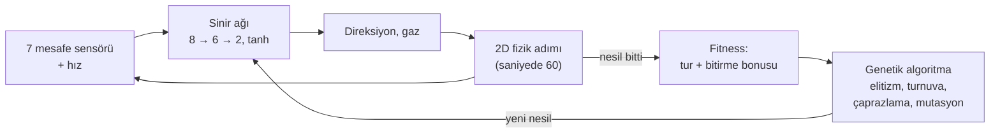

# NeuroDrive

[](https://github.com/omer-damar/Neurodrive/actions/workflows/ci.yml)


[](LICENSE)

**Tarayıcıda kendi kendine sürmeyi öğrenen arabalar.** Her arabayı, mesafe sensörlerini okuyan
küçük bir sinir ağı sürer; genetik algoritma en iyi sürücüleri bir sonraki nesle aktarır. Her şey
düz JavaScript ile elle yazıldı: yapay zekâ kütüphanesi, framework ve derleme adımı yok.
Simülasyon 2D; 2D ya da 3D (Three.js) izlenebilir.

**[▶ Canlı demoyu aç](https://omer-damar.github.io/Neurodrive/)** · [English](README.md)


## Öne çıkan sonuçlar

Beş kontrollü deney; her koşulda 10 sabit tohum ve kesin permütasyon testleri. Ayrıntılı anlatım
**[deney raporunda](docs/REPORT.tr.md)**.

| Soru | Bulgu |
|---|---|
| Mutasyon oranı önemli mi? | 0,3'ün altındaki oranlar daha yavaş öğreniyor; 0,3'ten 0,8'e kadar hız ve son beceri artık değişmiyor. |
| Beyinler hiç görmedikleri pistleri sürebiliyor mu? | **Üç pistte dönüşümlü** eğitim 5 görülmemiş pistin 3,1'ini bitiriyor, tek pist eğitimi 0,7'sini (p < 0,001). |
| Bazılarında neden hâlâ başarısızlar? | Eğitimdeki her virajdan keskin görülmemiş virajlar. Böyle virajlı tek bir eğitim pisti, geçilemeyen iki pisti **0/10'dan 8/10 ve 6/10** koşuya çıkarıyor (p = 0,002). |
| Kaç sensör gerekli? | 3 az, 5 yeterli; **9 ışın**, 5 ve 7'den **daha kötü genelleniyor** (p < 0,001). |
| Beyinler gürültülü sensörlere ne kadar dayanıklı? | ±0,1 gürültüye kadar dayanıklı; ±0,2'de çoğu koşu tur kaybediyor. Gürültüyle eğitmek ölçülebilir bir fark yaratmadı. |

## Özellikler

- **İzlenebilir öğrenme.** Her nesilde 100 araba. Lideri takip kamerası izler, liderin sinir ağı
  canlı çizilir, bir grafik nesil başına en iyi ve ortalama fitness'ı gösterir.
- **2D ve 3D.** 2D üstten görünüm ve takip, üstten (fare tekerleğiyle yakınlaştırma) ve serbest
  kameralı Three.js görünümü; low-poly arabalar, bariyerler ve pist kenarı dekoru. Görünüm
  değiştirmek eğitimi durdurmaz.
- **Pist editörü.** Fareyle ya da parmakla kendi kapalı pistini çiz; eğitilmiş beyinler yeni pistte
  sürmeye devam eder.
- **Beyinler.** En iyi beyni tarayıcıya kaydet, JSON olarak indir ya da yükle veya üç hazır pistin
  hepsinde tur atan gömülü hazır beyinle başla.
- **Sen vs YZ.** Hazır beyinle ya da eğitimin şampiyonuyla ok tuşları veya WASD ile yarış
  (telefonda dokunmatik düğmeler), altı araba modelinden birini seç, her pistteki rekorunu kovala.
- **Deneyler.** İstatistiksel olarak sınanmış beş kontrollü deney ve ayrıntılı bir
  [rapor](docs/REPORT.tr.md).
- **Türkçe ve İngilizce** arayüz.


## Nasıl çalışır



1. **Sensörler.** Her araba ±67,5° aralığında 7 ışın gönderir. Işın değeri `1 − mesafe / menzil`
   (0 = boş, 1 = duvara değiyor); arabanın hızı 8. girdidir.
2. **Ağ.** `tanh` aktivasyonlu `[8, 6, 2]` ileri beslemeli ağ, girdileri direksiyon ve gaza
   çevirir. Ağırlıklar düz `Float64Array`'lerdir ([`neuralNetwork.js`](src/core/neuralNetwork.js)).
3. **Fizik.** Sabit zaman adımlı, deterministik 2D araba fiziği. Yüksek hızda yol tutuş azalır;
   arabalar virajdan önce yavaşlamayı öğrenmek zorundadır. Duvara çarpan, takılan ya da geri dönen
   araba elenir.
4. **Fitness.** Tamamlanan tur oranı ve üç turu erken bitirene bonus.
5. **Evrim.** En iyi iki beyin olduğu gibi kalır; geri kalanlar turnuva seçimi (k = 3), uniform
   çaprazlama ve Gauss mutasyonuyla (oran 0,1, şiddet 0,5) üretilir.

Tüm rastgelelik tek bir tohumlu üreteçten (`mulberry32`) gelir: aynı tohum ve ayarlar, tarayıcıda da
Node'da da aynı koşuyu verir.

## Deneyler

Deneyler "arabalar öğreniyor" iddiasını ölçülmüş, tekrar üretilebilir iddialara dönüştürüyor. Her
deney Node'da ekransız eğitilir, her koşulda 1–10 tohumlarını kullanır, yalnızca tek bir değişkeni
değiştirir, ortalama ± standart sapma verir ve her karşılaştırmayı kesin bir permütasyon testiyle
sınar (Holm düzeltmeli, etki büyüklüğü olarak Cliff's δ ile). Tanımlar ve ham CSV'ler repoda; tek
bir komut her grafiği ve tabloyu yeniden üretir.

**[Ayrıntılı deney raporunu oku →](docs/REPORT.tr.md)** Rapor, yöntemi ve istatistikleri sade bir
dille açıklıyor; her deney için neden önemli olduğunu, hipotezi, tasarımı, sonuçları, yorumu ve
sınırlılıkları veriyor.

| # | Deney | Tek cümlelik sonuç |
|---|---|---|
| 1 | Mutasyon oranı (0,05 → 0,8) | En az orta düzeyde (≥ 0,3) mutasyon kullan; elitizm varken fazlası bir şey kaybettirmiyor. |
| 2 | Beş görülmemiş piste genelleme | Bir beynin hiç görmediği pistleri sürebilmesini sağlayan şey çeşitli eğitim pistleri. |
| 3 | Eğitimde keskin virajlar | Bir beyin bir viraj için ancak daha önce o keskinlikte virajlarla karşılaştıysa yavaşlıyor. |
| 4 | Sensör sayısı (3 / 5 / 7 / 9) | Beş sensör yetiyor; fazlası genellemeyi iyileştirmek yerine kötüleştirebilir. |
| 5 | Gürültülü sensörler (±0 → ±0,2) | Beyinler orta düzey gürültüyü kaldırıyor; gürültüyle eğitmek ölçülebilir bir fark yaratmadı. |

İki merkezî sonuç: dönüşümlü eğitim tek pistte eğitimden çok daha iyi genelleniyor ve hâlâ
geçemediği pistler, eğitim pistlerinden biri o keskinlikte virajlar içerince geçilebilir hale
geliyor.


## Mimari

Simülasyon ve görüntü kesin olarak ayrıdır. Simülasyon yalnızca 2D durum (`x, y, angle, …`) üretir;
çiziciler bu durumu okur, asla değiştirmez.

```
src/core/          DOM'suz mantık; tarayıcıda, testlerde ve ekransız eğitimde çalışır
  track.js         spline pistler, duvarlar, ilerleme, doğrulama
  car.js           fizik, sensörler, çarpışma, turlar
  neuralNetwork.js, genetics.js, simulation.js
  race.js          sen vs YZ yarış kuralları
  trackSketch.js   elle çizilen iz → geçerli pist
src/ui/            yalnızca tarayıcı
  main.js          uygulama durumu ve sabit adımlı kare döngüsü
  renderer2d.js    canvas 2D çizici
  three/           Three.js'i import eden tek kod; 3D'ye ilk geçişte yüklenir
  editor.js, race.js, chart.js, networkView.js, storage.js, i18n.js
scripts/           ekransız eğitim, deneyler ve bağımlılıksız SVG grafikler
tests/             node --test, bağımlılık yok
```

- **Tek çizici arayüzü:** `setTrack(track)`, `render(scene, view)`, `resize()`, `dispose()`.
  Eğitim, yarış ve editör aynı salt-okunur sahneyi sağlar: `{ track, cars, leader }`.
- **Tek 2D → 3D eşlemesi:** dünya `(x, y)` → Three.js `(x · 0,05, 0, y · 0,05)`.
- **Sabit zaman adımı:** kare döngüsü gerçek süreyi biriktirip tam fizik adımları atar; hız ekranın
  yenileme hızına bağlı değildir. Arabalar çizilirken iki adım arasında ara değerlenir.
- **Ölçekte 3D:** her araba modeli parçası tek bir `InstancedMesh`; yüzlerce araba birkaç çizim
  çağrısına mal olur. Yalnızca lider, dönen ön tekerlekleriyle tam modeldir. WebGL ya da CDN yoksa
  uygulama 2D'de çalışmaya devam eder.

## Başlarken

ES modülleri `file://` üzerinden yüklenmez; klasörü bir sunucuyla aç ve <http://localhost:8000>
adresine git:

```bash
python -m http.server 8000
```

`npx serve .` da çalışır. 3D görünüm Three.js 0.160.0'ı CDN'den yükler.

Testleri çalıştır (Node 22+, bağımlılık yok):

```bash
npm test
```

Ekransız eğitim; şampiyon beyin `trained/` klasörüne JSON olarak yazılır ve uygulamada yüklenebilir:

```bash
npm run train -- --track classic --generations 80 --seed 42
```

Bir deneyi yeniden üret (her biri 4–10 dakika; yedisinin listesi
[raporda](docs/REPORT.tr.md#10-sonuçları-yeniden-üretmek)):

```bash
npm run experiment -- experiments/generalization.json
```

Hazır beyin şu komutla üretildi:
`npm run train -- --tracks oval,classic,technical --generations 90 --seed 42 --pretrained`.

## Credits

**Araba modelleri (CC BY 3.0, atıf zorunlu)**, [Poly Pizza](https://poly.pizza)'dan,
[Creative Commons Attribution 3.0](https://creativecommons.org/licenses/by/3.0/) lisansıyla.
Dosyalar değiştirilmedi (yalnızca yeniden adlandırıldı); uygulama onları çalışırken döndürür,
ölçekler ve renklendirir.

| Model | Yazar | Kaynak |
|---|---|---|
| "Mazda RX-7" | IvOfficial | <https://poly.pizza/m/SnIoWlh7S2> |
| "Dodge Charger" | David Sirera | <https://poly.pizza/m/4b80hRVxqvv> |
| "Car" | theking1322 | <https://poly.pizza/m/t8njpnyrxg> |
| "Convertible" | Poly by Google | <https://poly.pizza/m/dggOiBLYyuR> |
| "Camaro ZL1 2017" | Kris Tong | <https://poly.pizza/m/7bF7UVAoYRG> |
| "CAR Model" | Ignition Labs | <https://poly.pizza/m/5zUWP5UsLg-> |

**Diğer modeller (CC0):** [Kenney](https://www.kenney.nl) [Car Kit](https://kenney.nl/assets/car-kit)
ve [Racing Kit](https://kenney.nl/assets/racing-kit): yarış arabaları, tribünler, çadırlar,
ağaçlar, bayraklar ve panolar. Dosya listesi: [assets/models/LICENSE.md](assets/models/LICENSE.md).

**Kütüphane:** [Three.js](https://threejs.org) 0.160.0 (MIT), jsDelivr'den yüklenir.

## Lisans

Kod: [MIT](LICENSE) © 2026 Ömer Faruk Damar. 3D modeller kendi lisanslarını korur (bkz. Credits).
