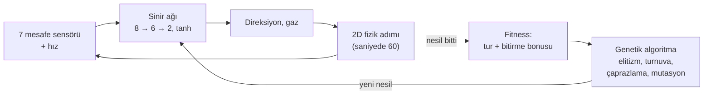

# NeuroDrive

[](https://github.com/omer-damar/Neurodrive/actions/workflows/ci.yml)


[](LICENSE)

**Tarayıcıda kendi kendine sürmeyi öğrenen arabalar.** Her arabayı, mesafe sensörlerini okuyan
küçük bir sinir ağı sürer; genetik algoritma en iyi sürücüleri bir sonraki nesle aktarır. Her şey
düz JavaScript ile elle yazıldı: yapay zekâ kütüphanesi, framework ve derleme adımı yok.
Simülasyon 2D; 2D ya da 3D (Three.js) izlenebilir.

**[▶ Canlı demoyu aç](https://omer-damar.github.io/Neurodrive/)** · [English](README.md)


## Öne çıkan sonuçlar

Koşul başına 10 sabit tohumla, ekransız ölçüldü (ortalama ± standart sapma). Aşağıdaki her sayı
tek bir komutla yeniden üretilebilir ([Deneyler](#deneyler)).

| Soru | Bulgu |
|---|---|
| Arabalar ne kadar hızlı öğreniyor? | En zor presette en iyi araba ilk turunu **5,7–10,1 nesilde** tamamlıyor; mutasyon oranı ne olursa olsun aynı tur süresine (≈ 8,7 sn) ulaşıyor. |
| Beyinler hiç görmedikleri pistleri sürebiliyor mu? | **Tek pistte** eğitim: 5 görülmemiş pistin 0,7'si bitirildi. **Üç pist dönüşümlü** eğitim: 5'in 3,1'i, her koşuda. |
| Bazı pistlerde neden hâlâ başarısızlar? | Eğitimdeki her virajdan keskin görülmemiş virajlar. Eğitime **böyle virajları olan tek bir pist** eklemek, geçilemeyen iki pisti 0/10 koşudan **8/10 ve 6/10** koşuya çıkarıyor. |

## Özellikler

- **İzlenebilir öğrenme.** Her nesilde 100 araba. Lideri takip kamerası izler, liderin sinir ağı
  canlı çizilir, bir grafik nesil başına en iyi ve ortalama fitness'ı gösterir.
- **2D ve 3D.** 2D üstten görünüm ve takip, üstten (fare tekerleğiyle yakınlaştırma) ve serbest
  kameralı Three.js görünümü; low-poly arabalar, bariyerler ve pist kenarı dekoru. Görünüm
  değiştirmek eğitimi durdurmaz.
- **Pist editörü.** Fareyle ya da parmakla kendi kapalı pistini çiz; eğitilmiş beyinler yeni pistte
  sürmeye devam eder.
- **Beyinler.** En iyi beyni tarayıcıya kaydet, JSON olarak indir ya da yükle veya üç hazır pistin
  hepsinde tur atan gömülü hazır beyinle başla.
- **Sen vs YZ.** Hazır beyinle ya da eğitimin şampiyonuyla ok tuşları veya WASD ile yarış
  (telefonda dokunmatik düğmeler), altı araba modelinden birini seç, her pistteki rekorunu kovala.
- **Türkçe ve İngilizce** arayüz.


## Nasıl çalışır



1. **Sensörler.** Her araba ±67,5° aralığında 7 ışın gönderir. Işın değeri `1 − mesafe / menzil`
   (0 = boş, 1 = duvara değiyor); arabanın hızı 8. girdidir.
2. **Ağ.** `tanh` aktivasyonlu `[8, 6, 2]` ileri beslemeli ağ, girdileri direksiyon ve gaza
   çevirir. Ağırlıklar düz `Float64Array`'lerdir ([`neuralNetwork.js`](src/core/neuralNetwork.js)).
3. **Fizik.** Sabit zaman adımlı, deterministik 2D araba fiziği. Yüksek hızda yol tutuş azalır;
   arabalar virajdan önce yavaşlamayı öğrenmek zorundadır. Duvara çarpan, takılan ya da geri dönen
   araba elenir.
4. **Fitness.** Tamamlanan tur oranı ve üç turu erken bitirene bonus.
5. **Evrim.** En iyi iki beyin olduğu gibi kalır; geri kalanlar turnuva seçimi (k = 3), uniform
   çaprazlama ve Gauss mutasyonuyla (oran 0,1, şiddet 0,5) üretilir.

Tüm rastgelelik tek bir tohumlu üreteçten (`mulberry32`) gelir: aynı tohum ve ayarlar, tarayıcıda da
Node'da da aynı koşuyu verir.

## Deneyler

**Tüm deneylerde ortak yöntem.** Eğitim Node'da ekransız çalışır. Yalnızca incelenen değişken
değişir, geri kalan her şey varsayılanında kalır. Her koşul 1–10 tohumlarıyla çalışır; sonuçlar
ortalama ± örneklem standart sapması olarak verilir. Tanımlar (`experiments/*.json`) ve ham CSV'ler
repoda; aynı komut aynı CSV'yi, grafiği ve tabloyu yeniden üretir.

### 1. Mutasyon oranı öğrenme hızını değiştiriyor mu?

**Kurulum.** `technical` pisti (en zor preset), nüfus 100, 50 nesil, mutasyon oranı
∈ {0,05, 0,1, 0,3}.


| Mutasyon oranı | İlk tura kadar nesil | Hiç tur atamayan koşu | En iyi tur (sn) |
|---|---|---|---|
| 0,05 | 10,1 ± 4,6 | 0 / 10 | 8,75 ± 0,03 |
| 0,1 | 8,4 ± 4,2 | 0 / 10 | 8,74 ± 0,03 |
| 0,3 | 5,7 ± 2,2 | 0 / 10 | 8,73 ± 0,02 |

**Çıkarım.** Bu aralıkta en yüksek oran en hızlı öğrendi; beklenen "orta oran en iyisi" görülmedi.
Son performans tüm koşullarda aynı.
**Sınırlılıklar.** Tek pist ve üç değer; mutasyonun zarar vermeye başladığı eşiği bulmak için daha
yüksek oranlar (0,5, 0,8) denenmeli.

### 2. Beyinler hiç görmedikleri pistleri sürebiliyor mu?

**Kurulum.** Aynı bütçeyle iki koşul (60 nesil, nüfus 100): tek pistte (`classic`) ya da üç presette
dönüşümlü (pist her nesil değişir) eğitim. Her koşunun şampiyonu yalnızca kendi eğitim pistlerinde
seçilir, sonra **hiçbir koşulda eğitimde olmayan beş yeni pisti** öğrenmeden birer kez sürer.


| Eğitim | Görülmemiş pist başına tur (3 üzerinden) | Bitirilen görülmemiş pist (5 üzerinden) | Eğitim pistlerinde tur |
|---|---|---|---|
| Tek pist (`classic`) | 0,44 ± 0,67 | 0,7 ± 1,1 | 3,00 ± 0,00 |
| Dönüşümlü (oval, classic, technical) | 1,86 ± 0,19 | 3,1 ± 0,3 | 3,00 ± 0,00 |

**Çıkarım.** İki koşul da kendi pistlerini tam sürüyor, ama dönüşümlü eğitim çok daha iyi ve çok daha
tutarlı genelleniyor: `square`, `snake` ve `bean`'i 10 koşunun 10'unda bitirdi (tek pist eğitimi: 3,
2 ve 2). `triangle` ve `horseshoe`'yu hazır beyin dahil neredeyse hiçbir beyin geçemedi. Hepsi aynı
yerde çarpıyor: pistin tam hızla girilen en keskin virajında. Bu virajlar eğitim pistlerindeki her
virajdan keskin (≈ 480 birimlik yayda 1,76 ve −2,17 rad; eğitimde en fazla 1,67 ve −1,38).
**Sınırlılıklar.** Test pistleri elle tasarlandı (yalnızca geçerli ve sürülebilir oldukları kontrol
edildi, koşullara göre ayarlanmadı). Dönüşümlü eğitim hem daha çok pist hem daha çeşitli viraj
görüyor; bu deney tek başına hangisinin etkili olduğunu söyleyemez. Deney 2b ikisini ayırıyor.

### 2b. Sebep keskin virajlar mı?

**Kurulum.** İki koşul da **dört** pisti dönüşümlü kullanıyor: üç preset ve bir yeni pist. Pist
sayısı aynı; yalnızca dördüncü pistin virajları farklı. *Yumuşak* koşul, virajları presetlerin
aralığında kalan bir pist ekliyor. *Keskin* koşul, en zor virajları geçilemeyen iki test pistiyle
eşleşen bir pist ekliyor (1,73 ve −2,18 rad; pist doğrulayıcı daha keskinine izin vermiyor). Aynı beş
görülmemiş pist, 60 nesil.


| Dördüncü eğitim pisti | Görülmemiş pist başına tur (3 üzerinden) | Bitirilen görülmemiş pist (5 üzerinden) | `triangle` bitiren | `horseshoe` bitiren |
|---|---|---|---|---|
| Yumuşak virajlı | 1,80 ± 0,00 | 3,0 ± 0,0 | 0 / 10 | 0 / 10 |
| Keskin virajlı | 2,54 ± 0,68 | 4,2 ± 1,2 | 8 / 10 | 6 / 10 |

**Çıkarım.** Viraj açıklaması doğrulandı. Yumuşak bir dördüncü pist hiçbir şeyi değiştirmiyor;
keskin bir pist ise üçgeni 10 koşunun 8'inde, at nalını 6'sında geçilir kılıyor, kolay pistler de
hemen her koşuda bitirilmeye devam ediyor. Bir beyin, ancak eğitimde o keskinlikte virajlarla
karşılaştıysa böyle bir viraj için yavaşlamayı öğreniyor.
**Sınırlılıklar.** Keskin koşuldaki bir koşu (tohum 4), kendi dört eğitim pistinin hepsini süren bir
beyin bulamadı ve test pistlerinde de kötüydü: keskin pist eğitimi zorlaştırıyor, saçılmanın büyük
olması bundan. Keskin pist, geçilemeyen virajlara göre tasarlandı; sonuç "bu tür virajlar eğitimde
görülmeli" der, "herhangi bir keskin pist yeter" demez.

## Mimari

Simülasyon ve görüntü kesin olarak ayrıdır. Simülasyon yalnızca 2D durum (`x, y, angle, …`) üretir;
çiziciler bu durumu okur, asla değiştirmez.

```
src/core/          DOM'suz mantık; tarayıcıda, testlerde ve ekransız eğitimde çalışır
  track.js         spline pistler, duvarlar, ilerleme, doğrulama
  car.js           fizik, sensörler, çarpışma, turlar
  neuralNetwork.js, genetics.js, simulation.js
  race.js          sen vs YZ yarış kuralları
  trackSketch.js   elle çizilen iz → geçerli pist
src/ui/            yalnızca tarayıcı
  main.js          uygulama durumu ve sabit adımlı kare döngüsü
  renderer2d.js    canvas 2D çizici
  three/           Three.js'i import eden tek kod; 3D'ye ilk geçişte yüklenir
  editor.js, race.js, chart.js, networkView.js, storage.js, i18n.js
scripts/           ekransız eğitim, deneyler ve bağımlılıksız SVG grafikler
tests/             node --test, bağımlılık yok
```

- **Tek çizici arayüzü:** `setTrack(track)`, `render(scene, view)`, `resize()`, `dispose()`.
  Eğitim, yarış ve editör aynı salt-okunur sahneyi sağlar: `{ track, cars, leader }`.
- **Tek 2D → 3D eşlemesi:** dünya `(x, y)` → Three.js `(x · 0,05, 0, y · 0,05)`.
- **Sabit zaman adımı:** kare döngüsü gerçek süreyi biriktirip tam fizik adımları atar; hız ekranın
  yenileme hızına bağlı değildir. Arabalar çizilirken iki adım arasında ara değerlenir.
- **Ölçekte 3D:** her araba modeli parçası tek bir `InstancedMesh`; yüzlerce araba birkaç çizim
  çağrısına mal olur. Yalnızca lider, dönen ön tekerlekleriyle tam modeldir. WebGL ya da CDN yoksa
  uygulama 2D'de çalışmaya devam eder.

## Başlarken

ES modülleri `file://` üzerinden yüklenmez; klasörü bir sunucuyla aç ve <http://localhost:8000>
adresine git:

```bash
python -m http.server 8000
```

`npx serve .` da çalışır. 3D görünüm Three.js 0.160.0'ı CDN'den yükler.

Testleri çalıştır (Node 22+, bağımlılık yok):

```bash
npm test
```

Ekransız eğitim; şampiyon beyin `trained/` klasörüne JSON olarak yazılır ve uygulamada yüklenebilir:

```bash
npm run train -- --track classic --generations 80 --seed 42
```

Deneyleri yeniden üret (her biri yaklaşık 4–5 dakika):

```bash
npm run experiment -- experiments/mutation-rate.json
```

```bash
npm run experiment -- experiments/generalization.json
```

```bash
npm run experiment -- experiments/generalization-corners.json
```

Hazır beyin şu komutla üretildi:
`npm run train -- --tracks oval,classic,technical --generations 90 --seed 42 --pretrained`.

## Credits

**Araba modelleri (CC BY 3.0, atıf zorunlu)**, [Poly Pizza](https://poly.pizza)'dan,
[Creative Commons Attribution 3.0](https://creativecommons.org/licenses/by/3.0/) lisansıyla.
Dosyalar değiştirilmedi (yalnızca yeniden adlandırıldı); uygulama onları çalışırken döndürür,
ölçekler ve renklendirir.

| Model | Yazar | Kaynak |
|---|---|---|
| "Mazda RX-7" | IvOfficial | <https://poly.pizza/m/SnIoWlh7S2> |
| "Dodge Charger" | David Sirera | <https://poly.pizza/m/4b80hRVxqvv> |
| "Car" | theking1322 | <https://poly.pizza/m/t8njpnyrxg> |
| "Convertible" | Poly by Google | <https://poly.pizza/m/dggOiBLYyuR> |
| "Camaro ZL1 2017" | Kris Tong | <https://poly.pizza/m/7bF7UVAoYRG> |
| "CAR Model" | Ignition Labs | <https://poly.pizza/m/5zUWP5UsLg-> |

**Diğer modeller (CC0):** [Kenney](https://www.kenney.nl) [Car Kit](https://kenney.nl/assets/car-kit)
ve [Racing Kit](https://kenney.nl/assets/racing-kit): yarış arabaları, tribünler, çadırlar,
ağaçlar, bayraklar ve panolar. Dosya listesi: [assets/models/LICENSE.md](assets/models/LICENSE.md).

**Kütüphane:** [Three.js](https://threejs.org) 0.160.0 (MIT), jsDelivr'den yüklenir.

## Lisans

Kod: [MIT](LICENSE) © 2026 Ömer Faruk Damar. 3D modeller kendi lisanslarını korur (bkz. Credits).
