# NeuroDrive: Experiment Report

[Türkçe](REPORT.tr.md) · [Back to the README](../README.md)

## Abstract

NeuroDrive trains simulated cars to drive with a small neural network whose weights are found by a
genetic algorithm. This report asks nine questions about that learning process and answers each
with a controlled, reproducible experiment: 10 fixed random seeds per condition, one variable
changed at a time, and exact permutation tests for every comparison.

| # | Question | Answer | Evidence |
|---|---|---|---|
| 1 | Does the mutation rate change how fast cars learn? | Low rates (0.05) learn slower than 0.3; above 0.3 the speed no longer changes, even at 0.8. Final skill is identical. | 0.05 vs 0.3: p = 0.044 (Holm), large effect. 0.3 / 0.5 / 0.8: no difference. |
| 2 | Do trained brains drive tracks they have never seen? | Training on three tracks in rotation generalizes far better than training on one. | 1.86 vs 0.44 laps per unseen track, p < 0.001, δ = −0.91. |
| 3 | Why do they still fail some unseen tracks? | Those tracks contain corners sharper than any in training. Adding one track with such corners fixes most failures. | Failed tracks: 0/10 → 8/10 and 6/10 runs finished; p = 0.002, δ = −0.80. |
| 4 | How many distance sensors does a car need? | 3 are not enough; 5 are. 9 sensors learn as fast as 5–7 but generalize worse. | 3 vs ≥ 5 rays: p < 0.001. 9 vs 5 or 7 rays on unseen tracks: p < 0.001, δ ≈ −0.9. |
| 5 | How robust are the brains to noisy sensors? | Robust up to ±0.1 noise; at ±0.2 performance drops in most runs. Training with noise did not measurably help. | Drop at ±0.2: δ = +0.60, p = 0.031 (0.19 after Holm). Noisy vs exact training: all p ≥ 0.21. |
| 6 | Does a bigger network generalize worse? | No. 4 to 16 hidden neurons generalize and drive identically, so Experiment 4's 9-sensor result is not caused by network size. | All comparisons p = 1.000 (laps) and ≥ 0.50 (race time). |
| 7 | Same budget: more cars or more generations? | Which unseen tracks are passed does not change; more generations make the driving measurably faster. | Race time 24.62 s (50 × 120) vs 25.03 s (200 × 30), p < 0.001, δ = −1.00. |
| 8 | Is it the number of sensors or their spacing? | The spacing. Rays packed closer than 22.5° hurt generalization whether there are 7 or 9 of them; 9 rays spread wider are fine. | Same count, dense vs wide: p ≤ 0.010, δ ≥ 0.73. Same spacing, 7 vs 9 rays: no difference. |
| 9 | How many training tracks are needed? | Two, if the second brings harder corners; a third and fourth easy track add nothing. | 1 vs 2 tracks: p < 0.001, δ = −0.91. 2 vs 3 vs 4: p = 1.000. |

The common thread: **what the brain has seen in training matters more than how much it can see,
how large it is, or how its weights are perturbed.** Varied corners in training buy generalization;
extra sensors, extra neurons, extra easy tracks and extra mutation do not.

## Contents

1. [The system under study](#1-the-system-under-study)
2. [Method shared by all experiments](#2-method-shared-by-all-experiments)
3. [Experiment 1: mutation rate](#3-experiment-1-mutation-rate)
4. [Experiment 2: generalization to unseen tracks](#4-experiment-2-generalization-to-unseen-tracks)
5. [Experiment 3: is it the sharp corners?](#5-experiment-3-is-it-the-sharp-corners)
6. [Experiment 4: how many sensors?](#6-experiment-4-how-many-sensors)
7. [Experiment 5: noisy sensors](#7-experiment-5-noisy-sensors)
8. [Experiment 6: network size](#8-experiment-6-network-size)
9. [Experiment 7: population or generations?](#9-experiment-7-population-or-generations)
10. [Experiment 8: ray count or ray spacing?](#10-experiment-8-ray-count-or-ray-spacing)
11. [Experiment 9: how many training tracks?](#11-experiment-9-how-many-training-tracks)
12. [Discussion](#12-discussion)
13. [Threats to validity](#13-threats-to-validity)
14. [Reproducing the results](#14-reproducing-the-results)

## 1. The system under study

- **Car.** A point on a 2D track with simple physics: throttle, braking, steering, and grip that
  falls at high speed, so a car must slow down before tight corners. It is out of the race when it
  touches a wall, stops making progress for 2.5 s, or turns back.
- **Sensors.** By default 7 rays fanned over ±67.5° in front of the car. Each ray reports how close
  the nearest wall is, from 0 (nothing within range) to 1 (touching). The car's speed is one more
  input.
- **Brain.** A feed-forward neural network `[inputs, 6 hidden, 2 outputs]` with `tanh`
  activations. The outputs are steering and throttle. Nothing is learned by gradient descent; the
  weights are only ever changed by evolution.
- **Evolution.** A population of 100 cars drives at once. When all are out (or 60 s pass), each
  car gets a **fitness**: laps completed as a fraction, plus a bonus for finishing three laps
  early. The two best brains are copied unchanged (**elitism**); the other 98 are bred by
  tournament selection, uniform crossover and Gaussian mutation (default rate 0.1, strength 0.5).
- **Tracks.** Three presets of increasing difficulty: `oval`, `classic` and `technical`.

## 2. Method shared by all experiments

**Runs and seeds.** All training runs headlessly in Node, with the same code as the browser. Every
random choice comes from one seeded generator, so a run is fully determined by its settings and
its seed. Each condition is run with **seeds 1–10**, giving 10 independent runs per condition.
Only the variable under study changes between conditions; everything else stays at its default.

**Consistency checks.** Where two experiments share a condition, they reproduce it exactly: the
mutation rate 0.3 runs are identical in Experiments 1a and 1b, and the "three tracks in rotation,
7 sensors, 6 hidden neurons, 100 cars × 60 generations, no noise" condition gives the same
1.86 ± 0.19 laps in Experiments 2, 4b, 5, 6 and 7.

**Champion.** Experiments 2–5 test one brain per run, its *champion*: after each generation the
two elites are each driven alone on the run's own training tracks, and the brain that drives the
worst of them best (then the most laps overall) is kept. Test tracks are never used to choose it.

**Unseen test tracks.** Five hand-designed tracks that no condition ever trains on: `triangle`,
`horseshoe`, `square`, `snake` and `bean`. They were checked only to be valid and drivable by a
simple scripted driver; they were not tuned to any condition.

**Measures.**

| Measure | Meaning |
|---|---|
| Generations to the first lap | The first generation in which the best car completes a full lap. Lower = faster learning. |
| Best lap | The fastest single lap seen in the whole run, in seconds. |
| Laps on a track (0–3) | The champion drives a track once, alone and without learning, for at most 60 s. 3 means it finished the race. |
| Tracks finished | How many tracks the champion completed all 3 laps on. |
| Race time (secondary) | Mean time of the 3-lap race on the unseen tracks that **every** run of **every** condition in the experiment finished, so all runs are timed on the same tracks. Lower = faster driving. |

The race time was added after Experiment 7, where the lap counts saturated (nearly every run
passes the same tracks and fails the same ones). To avoid choosing a measure to fit one result, it
is computed by the fixed rule above for every generalization experiment; where no unseen track is
finished by every run (Experiments 2 and 4b), it is not reported.

**Statistics.** Results are reported as mean ± sample standard deviation over the 10 runs. Every
comparison between conditions is tested, and every test is deterministic:

- **Permutation test (unpaired).** If two conditions were really the same, the labels "A" and "B"
  on the 20 runs would be arbitrary. The test counts **every** way to relabel the 20 runs into two
  groups of 10 (184,756 ways) and reports the share that gives a difference at least as large as
  the one observed. That share is the *p*-value; it is exact, not an approximation.
- **Paired sign-flip test.** When the same brains are measured twice (with and without noise),
  each run's difference is tested instead: under "no effect" each difference is as likely positive
  as negative, and all 1,024 sign patterns are counted.
- **Holm correction.** When a report makes several comparisons, some would look significant by
  chance. Holm's method adjusts the *p*-values to keep the overall false-alarm rate at 5 %.
  Adjusted *p* < 0.05 is called significant.
- **Effect size, Cliff's δ.** *p* says whether a difference is real; δ says how big it is. δ is the
  probability that a run from A beats a run from B minus the probability that it loses, from −1
  to +1. |δ| ≥ 0.474 is conventionally a large effect, ≥ 0.33 medium, ≥ 0.147 small.

Ten runs per condition can reveal large effects reliably but may miss small ones. A result that is
not significant here means "not shown", not "shown to be absent".

## 3. Experiment 1: mutation rate

**Why it matters.** Mutation is the genetic algorithm's only source of new behaviour. Too little
and the population stops exploring; too much and good solutions are destroyed before they can
spread. Knowing where the useful range lies tells us how sensitive the method is to tuning.

**Hypothesis.** Learning speed has an optimum: very low and very high rates are both slower than a
middle value.

**Design.** Track `technical` (the hardest preset), population 100, 50 generations. Part 1a
compares rates 0.05, 0.1 and 0.3; part 1b extends the range to 0.3, 0.5 and 0.8. The rate is the
probability that each single weight is mutated in a child; the mutation size stays 0.5.

**Results.**



| Rate | Generations to the first lap | Runs without a lap | Best lap (s) |
|---|---|---|---|
| 0.05 | 10.1 ± 4.6 | 0 / 10 | 8.75 ± 0.03 |
| 0.1 (default) | 8.4 ± 4.2 | 0 / 10 | 8.74 ± 0.03 |
| 0.3 | 5.7 ± 2.2 | 0 / 10 | 8.73 ± 0.02 |
| 0.5 | 6.3 ± 2.3 | 0 / 10 | 8.72 ± 0.02 |
| 0.8 | 5.4 ± 2.4 | 0 / 10 | 8.73 ± 0.02 |

| Comparison (generations to the first lap) | Difference | p (Holm) | Cliff's δ |
|---|---|---|---|
| 0.05 vs 0.3 | +4.4 | **0.044** | +0.61 (large) |
| 0.05 vs 0.1 | +1.7 | 0.424 | +0.23 (small) |
| 0.1 vs 0.3 | +2.7 | 0.211 | +0.36 (medium) |
| 0.3 vs 0.5, 0.3 vs 0.8, 0.5 vs 0.8 | −0.6 to +0.9 | 1.000 | ≤ 0.29 |

**Interpretation.** Raising the rate from 0.05 to 0.3 makes learning measurably faster (4.4 fewer
generations to the first lap, a large effect). Beyond 0.3 the speed stops changing: even 0.8,
where most weights of every child are disturbed, learns as fast as 0.3. The hypothesis is only
half supported: there is a slow low end, but no harmful high end in this range. A likely reason is
elitism: the two best brains are always kept unmutated, so heavy mutation cannot destroy the best
solution found so far; it can only add more varied children around it. All rates reach the same
final lap time (≈ 8.73 s).

**Limitations.** One track and one mutation size; the interaction between rate and size, and the
role of elitism, were not tested directly.

**In one sentence:** mutate at least moderately (≥ 0.3); with elitism, more mutation costs nothing.

## 4. Experiment 2: generalization to unseen tracks

**Why it matters.** A brain that drives only the track it was trained on has memorized a route,
not learned to drive. Generalization to new tracks is the real test of learning, and it is the
central problem of machine learning in general.

**Hypothesis.** Training on several tracks in rotation generalizes better than training on one.

**Design.** Two conditions with the same budget, 60 generations of population 100: one track
(`classic`), or the three presets in rotation (the track changes every generation). Each run's
champion then drives the five unseen tracks.

**Results.**


| Training | Laps per unseen track (of 3) | Unseen tracks finished (of 5) | Laps on training tracks |
|---|---|---|---|
| One track (`classic`) | 0.44 ± 0.67 | 0.7 ± 1.1 | 3.00 ± 0.00 |
| Rotating (oval, classic, technical) | 1.86 ± 0.19 | 3.1 ± 0.3 | 3.00 ± 0.00 |

Difference in laps per unseen track: −1.42, **p < 0.001**, Cliff's δ = −0.91 (large).

**Interpretation.** Both conditions master their own training tracks, so the difference is not
about skill on known tracks. On new tracks, rotating training is far better and far more
consistent: it finished `square`, `snake` and `bean` in 10 of 10 runs, one-track training in 3, 2
and 2. Two tracks, `triangle` and `horseshoe`, were almost never passed by anyone, including the
built-in pretrained brain. Every brain crashes at the same place: the sharpest corner, entered at
full speed. Experiment 3 investigates why.

**Limitations.** Rotating training sees more tracks *and* more varied corners; this experiment
cannot tell which of the two matters. The test tracks are hand-designed.

**In one sentence:** varied training tracks are what make a brain drive tracks it has never seen.

## 5. Experiment 3: is it the sharp corners?

**Why it matters.** Experiment 2 ended with an explanation that was only an observation: the two
failed tracks have corners sharper than anything in training. An explanation becomes knowledge
only when it predicts the result of a new test.

**Measuring corners.** For every point on a track, the change of direction over the next and
previous ≈ 240 units of road (±24 centre points) is measured; a track's hardest corner is the
largest such turn, in radians, right turns positive. The training presets turn at most 1.67 right
and −1.38 left. The failed tracks turn **1.76** (triangle, right) and **−2.17** (horseshoe, left);
the passed tracks stay within 1.25 and −1.22.

**Hypothesis.** If a brain fails because it has never met corners that sharp, adding one training
track with such corners will let it pass the triangle and the horseshoe, and adding a track
without them will not.

**Design.** Both conditions train on **four** tracks in rotation: the three presets plus one new
track, so the number of tracks is equal. *Mild*: the fourth track's corners stay inside the
presets' range (1.12 / −0.37). *Sharp*: the fourth track's hardest corners match the failed test
tracks (1.73 / −2.18; the track validator allows nothing sharper). Same five unseen tracks, 60
generations, seeds 1–10.

**Results.**


| Fourth training track | Laps per unseen track | Tracks finished (of 5) | `triangle` finished | `horseshoe` finished |
|---|---|---|---|---|
| Mild corners | 1.80 ± 0.00 | 3.0 ± 0.0 | 0 / 10 | 0 / 10 |
| Sharp corners | 2.54 ± 0.68 | 4.2 ± 1.2 | 8 / 10 | 6 / 10 |

Difference in laps per unseen track: −0.74, **p = 0.002**, Cliff's δ = −0.80 (large).

**Interpretation.** The prediction held. A mild fourth track changes nothing: the triangle and the
horseshoe still fail in every run. A sharp one lets brains pass the triangle in 8 of 10 runs and
the horseshoe in 6 of 10, while the three easier tracks are still finished in nearly every run.
Because the number of tracks is the same in both conditions, this also resolves the limitation of
Experiment 2: it is the variety of corners, not merely the number of tracks, that drives
generalization.

**A cost.** The race-time measure shows what the sharp corners cost. The only unseen track every
run finished is `snake`; brains trained with the sharp track drive it in 31.51 ± 6.00 s, against
25.20 ± 0.13 s for the mild condition (p < 0.001, δ = −1.00). Having learned to brake hard for
very sharp corners, they also drive ordinary corners more cautiously: broader skill is bought with
speed.

**Limitations.** One run of the sharp condition (seed 4) never found a brain that drives all four
of its own training tracks and did poorly on the test tracks too: sharp corners make training
harder, which is why the spread is larger. The sharp track was designed to match the failed
corners, so the result shows that such corners must be seen in training, not that any sharp track
would do.

**In one sentence:** a brain slows down for a corner only if it has met corners that sharp before.

## 6. Experiment 4: how many sensors?

**Why it matters.** Sensors are a cost in real vehicles, and for a neural network each extra input
adds weights that evolution must tune. More information could help, or it could just enlarge the
search.

**Hypotheses.** (a) Learning is slower with too few sensors. (b) More sensors generalize better,
since the car sees its surroundings in more detail.

**Design.** 3, 5, 7 (default) or 9 rays, always spread over the same ±67.5° fan, so more rays means
denser coverage, not a wider view. Part 4a measures learning speed on `technical` (50 generations,
as in Experiment 1). Part 4b repeats Experiment 2's rotating training (60 generations) and tests
the champions on the five unseen tracks.

**Results.**


| Rays | Generations to the first lap | Runs without a lap | Best lap (s) |
|---|---|---|---|
| 3 | 26.9 ± 9.8 | **3 / 10** | 12.28 ± 1.24 |
| 5 | 8.4 ± 3.0 | 0 / 10 | 9.00 ± 0.04 |
| 7 | 8.4 ± 4.2 | 0 / 10 | 8.74 ± 0.03 |
| 9 | 7.5 ± 4.5 | 0 / 10 | 8.71 ± 0.05 |

3 rays vs any other count: **p < 0.001** (Holm), δ between +0.94 and +1.00. Between 5, 7 and 9
rays: p = 1.000, δ ≤ 0.10.


| Rays | Laps per unseen track | Tracks finished (of 5) | Laps on training tracks | `snake` finished |
|---|---|---|---|---|
| 3 | 1.18 ± 1.12 | 1.4 ± 1.9 | 1.83 ± 0.76 | 3 / 10 |
| 5 | 1.80 ± 0.00 | 3.0 ± 0.0 | 3.00 ± 0.00 | 10 / 10 |
| 7 | 1.86 ± 0.19 | 3.1 ± 0.3 | 3.00 ± 0.00 | 10 / 10 |
| 9 | 1.36 ± 0.23 | 2.1 ± 0.3 | 3.00 ± 0.00 | 1 / 10 |

9 vs 5 rays: −0.44 laps, **p < 0.001**, δ = −0.90; 9 vs 7 rays: −0.50 laps, **p < 0.001**,
δ = −0.91. 3 rays vs 5 or 7: not significant after Holm (p = 0.297), because the 3-ray runs vary
so much.

**Interpretation.** Hypothesis (a) is clearly supported: three rays leave blind spots large enough
that 3 of 10 runs never complete a lap, and the rest need three times as many generations. Five
rays are enough; beyond that, learning speed does not change and the best lap improves only
slightly (9.00 → 8.71 s). Hypothesis (b) is **contradicted**: 9-ray brains drive their own
training tracks perfectly but generalize worse than 5- or 7-ray brains, almost entirely because
they fail the `snake` track (1 of 10 runs finished, against 10 of 10). A first explanation was
overfitting: 10 inputs give the network more weights with which to fit the specific shapes of the
training tracks. **Experiment 6 tested this and did not support it:** networks with far more
weights than the 9-sensor one generalize as well as the default. **Experiment 8 then found the
cause: the spacing between the rays, not their number.**

**Limitations.** The fan width was kept fixed, so "more rays" also means "rays closer together".
The 3-ray runs that never lapped are left out of the learning-speed comparison, which makes 3 rays
look better than they are; the difference is significant anyway.

**In one sentence:** five sensors are enough, and more sensors can make generalization worse, not
better, because they end up too close together (Experiment 8).

## 7. Experiment 5: noisy sensors

**Why it matters.** Real sensors are never exact. A driving policy that collapses under slight
measurement noise is useless outside the simulator. Training with noise is a common way to make
policies robust.

**Hypotheses.** (a) Performance falls as sensor noise grows. (b) Brains trained with noise are
more robust than brains trained with exact sensors.

**Design.** Noise is added to every sensor reading at every step: a uniform random value in ±*a*
on the 0–1 scale, clamped back into 0–1. The noise has its own seeded generator, so runs remain
reproducible and noise-free runs are bit-for-bit unchanged. Two conditions, both with rotating
training for 60 generations: *exact* (no noise during training) and *noisy* (*a* = 0.1 during
training). Every champion is then tested at *a* = 0, 0.05, 0.1 and 0.2 on its training tracks
(where every champion is perfect without noise, so any drop is caused by the noise) and on the
five unseen tracks.

**Results.**


| Test noise | Exact training | Noisy training (±0.1) |
|---|---|---|
| ±0 | 3.00 ± 0.00 (30 / 30 finished) | 3.00 ± 0.00 (30 / 30) |
| ±0.05 | 2.90 ± 0.22 (28 / 30) | 2.93 ± 0.21 (29 / 30) |
| ±0.1 | 2.80 ± 0.32 (27 / 30) | 3.00 ± 0.00 (30 / 30) |
| ±0.2 | 2.47 ± 0.57 (23 / 30) | 2.60 ± 0.41 (24 / 30) |

*Laps per training track; "finished" counts drives over all runs and all three training tracks.*

| Comparison | Difference | p | p (Holm) | δ |
|---|---|---|---|---|
| Exact training, ±0 vs ±0.2 (paired) | +0.53 | 0.031 | 0.188 | +0.60 (large) |
| Noisy training, ±0 vs ±0.2 (paired) | +0.40 | 0.031 | 0.188 | +0.60 (large) |
| ±0 vs ±0.05 or ±0.1 (paired, both trainings) | 0.00 to +0.20 | ≥ 0.25 | 1.000 | ≤ 0.30 |
| Exact vs noisy training, at each noise level | −0.20 to 0.00 | ≥ 0.21 | ≥ 0.84 | ≤ 0.30 |

On the unseen tracks both conditions behave alike at every level (1.64–1.86 laps per track).

**Interpretation.** The brains are robust to moderate noise: at ±0.05 and ±0.1 the drop is small
and not significant. At ±0.2, a fifth of the whole sensor range, performance falls in 6 of 10 runs
in both conditions and rises in none (δ = +0.60); the uncorrected *p* is 0.031, but after
correcting for the six comparisons it is 0.19, so with 10 runs the drop is a strong trend rather
than a proven effect. Training with noise gave slightly better numbers at ±0.1 and ±0.2, but none
of these differences approaches significance: hypothesis (b) is not supported at this sample
size.

**Limitations.** One training noise level (0.1) and one noise model (uniform, independent per
sensor and step). Larger samples would be needed to detect the small benefits of noisy training,
if they exist.

**In one sentence:** the brains tolerate moderate sensor noise; at high noise they start to fail,
and training with noise made no measurable difference.

## 8. Experiment 6: network size

**Why it matters.** Experiment 4 left a candidate explanation: perhaps the 9-sensor network
generalizes worse because it has more weights and overfits its training tracks. If that is true,
a larger hidden layer, which adds far more weights, should hurt generalization too. Network size
is also the most common tuning question for any neural network.

**Hypothesis.** Larger networks generalize worse to unseen tracks (the overfitting explanation).

**Design.** 4, 6 (default), 12 or 16 hidden neurons, with 7 sensors and rotating training for 60
generations, as in Experiment 2. The networks have 46, 68, 134 and 178 weights; the 9-sensor
network of Experiment 4 has 80.

**Results.**


| Hidden neurons | Weights | Laps per unseen track | Tracks finished (of 5) | Race time on `square`, `snake`, `bean` (s) |
|---|---|---|---|---|
| 4 | 46 | 1.80 ± 0.00 | 3.0 ± 0.0 | 25.23 ± 0.14 |
| 6 | 68 | 1.86 ± 0.19 | 3.1 ± 0.3 | 25.20 ± 0.17 |
| 12 | 134 | 1.86 ± 0.19 | 3.1 ± 0.3 | 25.24 ± 0.17 |
| 16 | 178 | 1.80 ± 0.00 | 3.0 ± 0.0 | 25.20 ± 0.09 |

Every pairwise comparison: laps p = 1.000, race time p ≥ 0.50 (Holm p = 1.000), |δ| ≤ 0.28.

**Interpretation.** Network size makes no difference at all here: every size learns the training
tracks perfectly, passes the same unseen tracks and drives them equally fast. The hypothesis is
**not supported**, and with it the overfitting explanation of Experiment 4 falls: the 16-neuron
network has more than twice the weights of the 9-sensor network yet generalizes like the default.
The 9-sensor weakness must come from what the inputs are, not from how many weights process them;
Experiment 8 shows it is their spacing.
For this task, even 4 hidden neurons are enough capacity.

**Limitations.** Equal numbers of generations for all sizes; a larger network has a larger search
space and might benefit from longer training. "No difference" here means none was detected with
10 runs.

**In one sentence:** the network's size does not matter for this task; its inputs and its training
do.

## 9. Experiment 7: population or generations?

**Why it matters.** Every genetic algorithm spends a computing budget as population × generations.
Should that budget buy many cars for a few generations (broad search) or a few cars for many
generations (long refinement)? The answer guides how to set up training.

**Hypothesis.** With the budget fixed, the split between population and generations changes how
well the champions generalize.

**Design.** 6,000 car evaluations per run, split three ways: 50 cars × 120 generations, 100 × 60
(the default) and 200 × 30. Rotating training, five unseen tracks, seeds 1–10.

**Results.**


| Split | Laps per unseen track | Tracks finished (of 5) | Race time on `snake`, `bean` (s) |
|---|---|---|---|
| 50 cars × 120 generations | 1.74 ± 0.19 | 2.9 ± 0.3 | **24.62 ± 0.03** |
| 100 cars × 60 generations | 1.86 ± 0.19 | 3.1 ± 0.3 | 24.76 ± 0.18 |
| 200 cars × 30 generations | 1.86 ± 0.19 | 3.1 ± 0.3 | 25.03 ± 0.17 |

| Race time comparison | Difference | p (Holm) | Cliff's δ |
|---|---|---|---|
| 50 × 120 vs 100 × 60 | −0.14 s | **0.016** | −0.54 (large) |
| 50 × 120 vs 200 × 30 | −0.41 s | **< 0.001** | −1.00 (large) |
| 100 × 60 vs 200 × 30 | −0.27 s | **0.009** | −0.73 (large) |

Laps per unseen track: no significant difference (p = 1.000 after Holm).

**Interpretation.** The hypothesis is not supported for generalization: every split passes the
same three unseen tracks and fails the same two, because what decides that is the corners seen in
training (Experiment 3), not the budget. The two conditions with 100 and 200 cars even have
identical lap counts, by coincidence: each passed the triangle in exactly one run. The budget does
change the *quality* of the driving: the more generations, the faster the champions drive unseen
tracks they can handle, by about 1.6 % from 200 × 30 to 50 × 120, with large and significant
effects between every pair. Long refinement polishes the driving; broad search does not add new
skills.

**Limitations.** More generations also means more chances to pick a champion (one check per
generation), which may contribute to the effect. The absolute gain is small. The race time is the
secondary measure described in Section 2.

**In one sentence:** with a fixed budget, spend it on generations: you get the same skills, driven
faster.

## 10. Experiment 8: ray count or ray spacing?

**Why it matters.** Experiment 4 found that 9 sensors generalize worse than 7, and Experiment 6
ruled out network size as the cause. Two explanations remained, because in Experiment 4 more rays
also meant rays packed closer together: is it the **number** of inputs, or the **spacing**
between rays?

**Hypothesis.** The spacing is what matters: rays packed closer than the default hurt
generalization, whatever their number.

**Design.** A 2 × 2 design that separates the two. Each condition fixes the ray count and the fan
width so that the spacing between neighbouring rays is either the default 22.5° or the dense
16.9° of the 9-ray fan:

| Condition | Rays | Fan width | Spacing |
|---|---|---|---|
| A (default) | 7 | 135° | 22.5° |
| B (Experiment 4's weak case) | 9 | 135° | 16.9° |
| C | 9 | 180° | **22.5°** (as A) |
| D | 7 | 101.25° | **16.9°** (as B) |

If the spacing matters, C should behave like A and D like B. If the number of rays matters, C
should behave like B and D like A. Rotating training for 60 generations, five unseen tracks.

**Results.**


| Condition | Laps per unseen track | Tracks finished (of 5) | `snake` finished |
|---|---|---|---|
| A: 7 rays, 22.5° apart | 1.86 ± 0.19 | 3.1 ± 0.3 | 10 / 10 |
| B: 9 rays, 16.9° apart | 1.36 ± 0.23 | 2.1 ± 0.3 | 1 / 10 |
| C: 9 rays, 22.5° apart | 1.80 ± 0.00 | 3.0 ± 0.0 | 10 / 10 |
| D: 7 rays, 16.9° apart | 1.52 ± 0.23 | 2.3 ± 0.5 | 3 / 10 |

| Comparison | Difference | p (Holm) | Cliff's δ |
|---|---|---|---|
| A vs C (same spacing, 7 vs 9 rays) | +0.06 | 1.000 | +0.10 (negligible) |
| B vs D (same spacing, 9 vs 7 rays) | −0.16 | 0.384 | −0.40 (medium) |
| A vs D (same count, wide vs dense) | +0.34 | **0.010** | +0.73 (large) |
| C vs B (same count, wide vs dense) | +0.44 | **< 0.001** | +0.90 (large) |

All conditions learn their training tracks perfectly and drive the commonly finished tracks
equally fast (25.17–25.22 s, all p ≥ 0.28).

**Interpretation.** The prediction of the spacing explanation held on every point. With the
default spacing, 9 rays generalize as well as 7 (A vs C); with the dense spacing, 7 rays fail like
9 do (B vs D, no significant difference), and both dense conditions lose to their wide twins with
large, significant effects. Neither the number of rays nor the fan width fits all four results
(9 rays are good in C and poor in B; a 135° fan is good in A and poor in B); the spacing does. Both
dense conditions fail the same track, `snake`, with its tight S-bend. Why densely packed rays
hurt is still open; one possibility is that neighbouring rays then report nearly the same
distances, so the network gets less independent information about the road's shape for the same
number of inputs.

**Limitations.** Two spacings only; the effect of even wider spacing was not tested. The
mechanism above is a hypothesis.

**In one sentence:** it is not how many sensors a car has but how far apart they are; rays packed
too closely hurt generalization.

## 11. Experiment 9: how many training tracks?

**Why it matters.** Experiments 2 and 3 showed that varied training generalizes. A practical
follow-up: does every extra track help, or does a small, well-chosen set suffice?

**Hypothesis.** Generalization grows with the number of training tracks.

**Design.** 1 track (`classic`), 2 tracks (+ `technical`), 3 tracks (+ `oval`, as in Experiment 2)
and 4 tracks (+ the mild track of Experiment 3), all in rotation for 60 generations. Each step adds
one track to the previous set, so the number of tracks and which track is added change together.

**Results.**


| Training tracks | Laps per unseen track | Tracks finished (of 5) |
|---|---|---|
| 1 (`classic`) | 0.44 ± 0.67 | 0.7 ± 1.1 |
| 2 (+ `technical`) | 1.86 ± 0.19 | 3.1 ± 0.3 |
| 3 (+ `oval`) | 1.86 ± 0.19 | 3.1 ± 0.3 |
| 4 (+ mild) | 1.80 ± 0.00 | 3.0 ± 0.0 |

1 track vs 2, 3 or 4: **p < 0.001**, δ = −0.90 to −0.91 (large). Between 2, 3 and 4 tracks:
p = 1.000, |δ| ≤ 0.10.

**Interpretation.** The hypothesis is not supported as stated: all of the gain comes from the
second track, and the third and fourth add nothing. The second track is `technical`, which brings
the sharpest corners among the presets (1.67 / −1.38); `oval` and the mild track bring no corner
sharper than what is already covered. This is an independent confirmation of Experiment 3: what
counts is not how many tracks a brain trains on but which corners they contain. The results also
reproduce earlier ones exactly (1 track = Experiment 2's one-track condition, 4 tracks =
Experiment 3's mild condition).

**Limitations.** Each step adds a specific track, so "number of tracks" and "content of the added
track" cannot be separated here; adding `oval` before `technical` would likely move the jump.

**In one sentence:** a second track with harder corners is worth more than any number of easy
ones.

## 12. Discussion

Taken together, the experiments describe what this kind of neuroevolution learns:

- **Experience, not capacity, decides generalization.** Varied training tracks (Experiment 2) and
  in particular varied corners (Experiment 3) produce brains that drive new tracks. A larger
  network changed nothing (Experiment 6), extra easy tracks changed nothing (Experiment 9), and
  packing the sensors closer together made generalization worse (Experiments 4 and 8). This matches the central lesson of
  machine learning: a model generalizes to what its training data covers.
- **Generalization has a price.** Brains that learned to handle very sharp corners drive ordinary
  tracks more slowly (Experiment 3). Breadth and speed pull in different directions.
- **The search is robust.** With elitism, the genetic algorithm tolerated mutation rates from 0.3
  up to 0.8 without losing speed or final quality (Experiment 1), and the learned policies
  tolerated moderate sensor noise (Experiment 5). The method is forgiving to tune; where there is a
  choice, more generations refine the driving more than a larger population (Experiment 7).
- **There are hard limits in the inputs.** Three rays are too few to learn the hardest preset
  reliably (Experiment 4); somewhere between three and five, perception becomes sufficient.

## 13. Threats to validity

- **Sample size.** Ten runs per condition detect large effects reliably but can miss small ones.
  Non-significant results should be read as "not shown", not as "no effect".
- **Multiple experiments.** Holm correction is applied within each experiment's report, not across
  all experiments together.
- **Hand-designed tracks.** The unseen test tracks and the fourth training tracks were designed by
  the author. They were not tuned to any condition, but a different set of shapes could change
  the numbers.
- **One architecture.** Apart from Experiments 6 and 7, all experiments use one hidden layer of 6
  neurons, a population of 100 and 60 (or 50) generations. Deeper networks or much longer training
  could behave differently.
- **A measure added after the fact.** The race time (Section 2) was introduced after seeing
  Experiment 7's saturated lap counts. It is applied to every experiment by a fixed rule, but it
  was not planned in advance.
- **A simple world.** The physics is deliberately simple and deterministic. The results describe
  learning in this simulator, not real vehicles.

## 14. Reproducing the results

Every experiment is defined by a file in `experiments/`, writes its raw data to
`experiments/results/*.csv`, and regenerates its chart and full table in `docs/experiments/`. The
same command always produces the same files.

| Experiment | Command | Time |
|---|---|---|
| 1a. Mutation rate 0.05–0.3 | `npm run experiment -- experiments/mutation-rate.json` | ≈ 5 min |
| 1b. Mutation rate 0.3–0.8 | `npm run experiment -- experiments/mutation-rate-high.json` | ≈ 5 min |
| 2. Generalization | `npm run experiment -- experiments/generalization.json` | ≈ 4 min |
| 3. Sharp corners | `npm run experiment -- experiments/generalization-corners.json` | ≈ 4 min |
| 4a. Sensors, learning | `npm run experiment -- experiments/ray-count.json` | ≈ 5 min |
| 4b. Sensors, generalization | `npm run experiment -- experiments/ray-count-generalization.json` | ≈ 10 min |
| 5. Sensor noise | `npm run experiment -- experiments/sensor-noise.json` | ≈ 5 min |
| 6. Network size | `npm run experiment -- experiments/network-size.json` | ≈ 10 min |
| 7. Population or generations | `npm run experiment -- experiments/population-budget.json` | ≈ 10 min |
| 8. Ray count or spacing | `npm run experiment -- experiments/ray-spacing.json` | ≈ 12 min |
| 9. Number of training tracks | `npm run experiment -- experiments/track-count.json` | ≈ 10 min |

To redraw a chart and its table from an existing CSV without retraining:
`npm run plot -- experiments/<name>.json`.

The generated per-experiment tables (in Turkish, with every comparison) are in
[`docs/experiments/`](experiments/).
