# NeuroDrive: Deney Raporu

[English](REPORT.md) · [README'ye dön](../README.tr.md)

## Özet

NeuroDrive, simüle edilen arabalara küçük bir sinir ağıyla sürmeyi öğretir; ağın ağırlıklarını
genetik algoritma bulur. Bu rapor bu öğrenme süreci hakkında beş soru soruyor ve her birini
kontrollü, tekrar üretilebilir bir deneyle cevaplıyor: koşul başına 10 sabit tohum, her seferinde
tek bir değişken ve her karşılaştırma için kesin permütasyon testi.

| # | Soru | Cevap | Kanıt |
|---|---|---|---|
| 1 | Mutasyon oranı öğrenme hızını değiştiriyor mu? | Düşük oran (0,05), 0,3'ten yavaş öğreniyor; 0,3'ün üstünde hız artık değişmiyor, 0,8'de bile. Son beceri aynı. | 0,05 vs 0,3: p = 0,044 (Holm), büyük etki. 0,3 / 0,5 / 0,8: fark yok. |
| 2 | Eğitilmiş beyinler hiç görmedikleri pistleri sürebiliyor mu? | Üç pistte dönüşümlü eğitim, tek pistte eğitimden çok daha iyi genelleniyor. | Görülmemiş pist başına 1,86'ya karşı 0,44 tur, p < 0,001, δ = −0,91. |
| 3 | Bazı görülmemiş pistlerde neden hâlâ başarısızlar? | O pistlerde eğitimdekilerden keskin virajlar var. Eğitime böyle virajlı tek bir pist eklemek başarısızlıkların çoğunu gideriyor. | Geçilemeyen pistler: 0/10 → 8/10 ve 6/10 koşu; p = 0,002, δ = −0,80. |
| 4 | Bir arabanın kaç mesafe sensörüne ihtiyacı var? | 3 yetmiyor; 5 yetiyor. 9 sensör 5–7 kadar hızlı öğreniyor ama daha kötü genelleniyor. | 3 vs ≥ 5 ışın: p < 0,001. Görülmemiş pistlerde 9 vs 5 ya da 7 ışın: p < 0,001, δ ≈ −0,9. |
| 5 | Beyinler gürültülü sensörlere ne kadar dayanıklı? | ±0,1 gürültüye kadar dayanıklı; ±0,2'de çoğu koşuda performans düşüyor. Gürültüyle eğitmek ölçülebilir bir fark yaratmadı. | ±0,2'de düşüş: δ = +0,60, p = 0,031 (Holm sonrası 0,19). Gürültülü vs gürültüsüz eğitim: tüm p ≥ 0,21. |

Ortak tema: **beynin eğitimde ne gördüğü, ne kadar görebildiğinden ya da ağırlıklarının ne kadar
sarsıldığından daha önemli.** Çeşitli pistler ve keskin virajlar genelleme kazandırıyor; fazladan
sensör ve fazladan mutasyon kazandırmıyor.

## İçindekiler

1. [İncelenen sistem](#1-incelenen-sistem)
2. [Tüm deneylerde ortak yöntem](#2-tüm-deneylerde-ortak-yöntem)
3. [Deney 1: mutasyon oranı](#3-deney-1-mutasyon-oranı)
4. [Deney 2: görülmemiş pistlere genelleme](#4-deney-2-görülmemiş-pistlere-genelleme)
5. [Deney 3: sebep keskin virajlar mı?](#5-deney-3-sebep-keskin-virajlar-mı)
6. [Deney 4: kaç sensör?](#6-deney-4-kaç-sensör)
7. [Deney 5: gürültülü sensörler](#7-deney-5-gürültülü-sensörler)
8. [Tartışma](#8-tartışma)
9. [Geçerliliği tehdit eden etkenler](#9-geçerliliği-tehdit-eden-etkenler)
10. [Sonuçları yeniden üretmek](#10-sonuçları-yeniden-üretmek)

## 1. İncelenen sistem

- **Araba.** 2D bir pistte basit fizikle hareket eden bir nokta: gaz, fren, direksiyon ve yüksek
  hızda azalan yol tutuşu. Bu yüzden araba keskin virajlardan önce yavaşlamak zorunda. Duvara
  değerse, 2,5 sn ilerleme kaydetmezse ya da geri dönerse yarıştan çıkar.
- **Sensörler.** Varsayılan olarak arabanın önünde ±67,5°'lik bir yelpazeye yayılmış 7 ışın. Her
  ışın en yakın duvarın ne kadar yakın olduğunu söyler: 0 (menzilde duvar yok) ile 1 (değiyor)
  arası. Arabanın hızı da bir girdi daha.
- **Beyin.** `tanh` aktivasyonlu `[girdiler, 6 gizli, 2 çıktı]` ileri beslemeli sinir ağı.
  Çıktılar direksiyon ve gaz. Gradyan inişiyle hiçbir şey öğrenilmiyor; ağırlıkları yalnızca evrim
  değiştiriyor.
- **Evrim.** 100 arabalık bir nüfus aynı anda sürer. Hepsi elenince (ya da 60 sn dolunca) her
  arabaya bir **fitness** verilir: tamamlanan tur oranı ve üç turu erken bitirene bonus. En iyi
  iki beyin olduğu gibi kopyalanır (**elitizm**); diğer 98'i turnuva seçimi, uniform çaprazlama ve
  Gauss mutasyonuyla üretilir (varsayılan oran 0,1, şiddet 0,5).
- **Pistler.** Zorluğu artan üç hazır pist: `oval`, `classic` ve `technical`.

## 2. Tüm deneylerde ortak yöntem

**Koşular ve tohumlar.** Bütün eğitimler tarayıcıdakiyle aynı kodla, Node'da ekransız çalışır. Her
rastgele seçim tek bir tohumlu üreteçten gelir; yani bir koşu tamamen ayarları ve tohumuyla
belirlenir. Her koşul **1–10 tohumlarıyla** çalıştırılır, yani koşul başına 10 bağımsız koşu.
Koşullar arasında yalnızca incelenen değişken değişir; geri kalan her şey varsayılanında kalır.

**Tutarlılık kontrolleri.** İki deneyin ortak bir koşulu olduğunda o koşul birebir aynı çıkar:
0,3 mutasyon oranı koşuları Deney 1a ve 1b'de aynı; "üç pist dönüşümlü, 7 sensör, gürültü yok"
koşulu Deney 2, 4b ve 5'te aynı sonucu (1,86 ± 0,19 tur) veriyor.

**Şampiyon.** Deney 2–5 her koşudan tek bir beyni, *şampiyonu* test eder. Her nesilden sonra iki
elitin her biri tek başına koşunun kendi eğitim pistlerinde sürülür. Bunların en zorunu en iyi
süren beyin (eşitlikte toplamda en çok tur atan) saklanır. Test pistleri seçimde asla kullanılmaz.

**Görülmemiş test pistleri.** Hiçbir koşulun eğitimde görmediği, elle tasarlanmış beş pist:
`triangle`, `horseshoe`, `square`, `snake` ve `bean`. Yalnızca geçerli ve basit bir otomatik
sürücüyle sürülebilir oldukları kontrol edildi; hiçbir koşula göre ayarlanmadılar.

**Ölçütler.**

| Ölçüt | Anlamı |
|---|---|
| İlk tura kadar nesil | En iyi arabanın ilk kez tam bir tur attığı nesil. Düşük = hızlı öğrenme. |
| En iyi tur | Koşunun tamamında görülen en hızlı tek tur, saniye. |
| Pistte tur (0–3) | Şampiyon pisti tek başına ve öğrenmeden, en fazla 60 sn sürer. 3, yarışı bitirdiği anlamına gelir. |
| Bitirilen pist | Şampiyonun 3 turun hepsini tamamladığı pist sayısı. |

**İstatistik.** Sonuçlar 10 koşunun ortalaması ± örneklem standart sapması olarak verilir. Koşullar
arasındaki her karşılaştırma test edilir ve her test deterministiktir:

- **Permütasyon testi (eşsiz).** İki koşul aslında aynı olsaydı, 20 koşuya verilen "A" ve "B"
  etiketleri keyfi olurdu. Test, 20 koşuyu 10'arlı iki gruba ayırmanın **bütün** yollarını sayar
  (184.756 yol). Bunlar içinde, gözlenen fark kadar ya da daha büyük bir fark verenlerin oranı
  *p*-değeridir. Yaklaşık değil, kesindir.
- **Eşli işaret çevirme testi.** Aynı beyinler iki kez ölçüldüğünde (gürültülü ve gürültüsüz),
  her koşunun kendi farkı test edilir. "Etki yok" varsayımında her fark eşit olasılıkla artı ya da
  eksidir; 1.024 işaret düzeninin hepsi sayılır.
- **Holm düzeltmesi.** Bir raporda birden çok karşılaştırma yapılınca bazıları şans eseri anlamlı
  görünebilir. Holm yöntemi *p*-değerlerini, toplam yanlış alarm oranı %5'te kalacak şekilde
  düzeltir. Düzeltilmiş *p* < 0,05 anlamlı sayılır.
- **Etki büyüklüğü, Cliff's δ.** *p* farkın gerçek olup olmadığını, δ ise ne kadar büyük olduğunu
  söyler. δ, A'dan bir koşunun B'den bir koşuyu geçme olasılığı eksi ona yenilme olasılığıdır
  (−1…+1). |δ| ≥ 0,474 genelde büyük, ≥ 0,33 orta, ≥ 0,147 küçük etki sayılır.

Koşul başına on koşu büyük etkileri güvenilir biçimde ortaya çıkarır, ama küçük etkileri
kaçırabilir. Burada anlamlı çıkmayan bir sonuç "yok olduğu gösterildi" değil, "gösterilemedi"
demektir.

## 3. Deney 1: mutasyon oranı

**Neden önemli.** Mutasyon, genetik algoritmanın yeni davranış üretmesinin tek yolu. Azsa nüfus
keşfetmeyi bırakır; fazlaysa iyi çözümler yayılamadan bozulur. Yararlı aralığın nerede olduğu,
yöntemin ayara ne kadar duyarlı olduğunu gösterir.

**Hipotez.** Öğrenme hızının bir optimumu var: çok düşük ve çok yüksek oranlar orta bir değerden
yavaş.

**Tasarım.** `technical` pisti (en zor preset), nüfus 100, 50 nesil. Kısım 1a 0,05, 0,1 ve 0,3
oranlarını; kısım 1b aralığı genişletip 0,3, 0,5 ve 0,8'i karşılaştırıyor. Oran, bir yavrudaki her
bir ağırlığın mutasyona uğrama olasılığı; mutasyon büyüklüğü 0,5'te sabit.

**Sonuçlar.**

| Oran | İlk tura kadar nesil | Hiç tur atamayan koşu | En iyi tur (sn) |
|---|---|---|---|
| 0,05 | 10,1 ± 4,6 | 0 / 10 | 8,75 ± 0,03 |
| 0,1 (varsayılan) | 8,4 ± 4,2 | 0 / 10 | 8,74 ± 0,03 |
| 0,3 | 5,7 ± 2,2 | 0 / 10 | 8,73 ± 0,02 |
| 0,5 | 6,3 ± 2,3 | 0 / 10 | 8,72 ± 0,02 |
| 0,8 | 5,4 ± 2,4 | 0 / 10 | 8,73 ± 0,02 |

| Karşılaştırma (ilk tura kadar nesil) | Fark | p (Holm) | Cliff's δ |
|---|---|---|---|
| 0,05 vs 0,3 | +4,4 | **0,044** | +0,61 (büyük) |
| 0,05 vs 0,1 | +1,7 | 0,424 | +0,23 (küçük) |
| 0,1 vs 0,3 | +2,7 | 0,211 | +0,36 (orta) |
| 0,3 vs 0,5, 0,3 vs 0,8, 0,5 vs 0,8 | −0,6 ile +0,9 arası | 1,000 | ≤ 0,29 |

**Yorum.** Oranı 0,05'ten 0,3'e çıkarmak öğrenmeyi ölçülebilir biçimde hızlandırıyor (ilk tura
4,4 nesil daha erken, büyük etki). 0,3'ün üstünde hız artık değişmiyor: her yavrunun
ağırlıklarının çoğunun sarsıldığı 0,8 bile 0,3 kadar hızlı öğreniyor. Hipotez yalnızca yarı yarıya
destekleniyor: yavaş bir alt uç var, ama bu aralıkta zararlı bir üst uç yok. Muhtemel neden
elitizm: en iyi iki beyin her zaman mutasyonsuz saklandığı için yoğun mutasyon şimdiye kadarki en
iyi çözümü bozamıyor, yalnızca onun etrafında daha çeşitli yavrular üretiyor. Bütün oranlar aynı
son tur süresine (≈ 8,73 sn) ulaşıyor.

**Sınırlılıklar.** Tek pist ve tek mutasyon büyüklüğü; oran ile büyüklüğün etkileşimi ve
elitizmin rolü doğrudan test edilmedi.

**Tek cümleyle:** en az orta düzeyde (≥ 0,3) mutasyon kullan; elitizm varken fazlası bir şey
kaybettirmiyor.

## 4. Deney 2: görülmemiş pistlere genelleme

**Neden önemli.** Yalnızca eğitildiği pisti sürebilen bir beyin sürmeyi değil, bir rotayı
ezberlemiştir. Yeni pistlere genelleme, öğrenmenin asıl sınavı ve genel olarak makine
öğrenmesinin merkezî problemi.

**Hipotez.** Birkaç pistte dönüşümlü eğitim, tek pistte eğitimden daha iyi genellenir.

**Tasarım.** Aynı bütçeyle iki koşul, 100 nüfusla 60 nesil: tek pist (`classic`) ya da üç presette
dönüşümlü (pist her nesil değişir). Ardından her koşunun şampiyonu beş görülmemiş pisti sürer.

**Sonuçlar.**

| Eğitim | Görülmemiş pist başına tur (3 üzerinden) | Bitirilen görülmemiş pist (5 üzerinden) | Eğitim pistlerinde tur |
|---|---|---|---|
| Tek pist (`classic`) | 0,44 ± 0,67 | 0,7 ± 1,1 | 3,00 ± 0,00 |
| Dönüşümlü (oval, classic, technical) | 1,86 ± 0,19 | 3,1 ± 0,3 | 3,00 ± 0,00 |

Görülmemiş pist başına tur farkı: −1,42, **p < 0,001**, Cliff's δ = −0,91 (büyük).

**Yorum.** İki koşul da kendi eğitim pistlerini tam sürüyor; yani fark bilinen pistlerdeki
beceriyle ilgili değil. Yeni pistlerde dönüşümlü eğitim çok daha iyi ve çok daha tutarlı:
`square`, `snake` ve `bean`'i 10 koşunun 10'unda bitirdi, tek pist eğitimi ise 3, 2 ve 2'sinde.
İki pisti, `triangle` ve `horseshoe`'yu gömülü hazır beyin dahil neredeyse hiçbir beyin geçemedi.
Hepsi aynı yerde çarpıyor: tam hızla girilen en keskin virajda. Deney 3 bunun nedenini araştırıyor.

**Sınırlılıklar.** Dönüşümlü eğitim hem daha çok pist *hem de* daha çeşitli viraj görüyor; bu
deney ikisinden hangisinin etkili olduğunu ayıramaz. Test pistleri elle tasarlandı.

**Tek cümleyle:** bir beynin hiç görmediği pistleri sürebilmesini sağlayan şey çeşitli eğitim
pistleri.

## 5. Deney 3: sebep keskin virajlar mı?

**Neden önemli.** Deney 2 yalnızca bir gözleme dayanan bir açıklamayla bitti: geçilemeyen iki
pistte eğitimdekilerden keskin virajlar var. Bir açıklama, ancak yeni bir testin sonucunu doğru
tahmin ettiğinde bilgiye dönüşür.

**Virajları ölçmek.** Pistin her noktasında, yolun ≈ 240 birim ilerisi ve gerisi (±24 merkez
noktası) arasındaki yön değişimi ölçülür; bir pistin en zor virajı bunların en büyüğüdür (radyan,
sağa dönüş artı). Eğitim presetleri en fazla 1,67 sağa ve −1,38 sola dönüyor. Geçilemeyen pistler
**1,76** (üçgen, sağ) ve **−2,17** (at nalı, sol) dönüyor; geçilenler 1,25 ve −1,22 içinde kalıyor.

**Hipotez.** Bir beyin bu kadar keskin virajla hiç karşılaşmadığı için başarısız oluyorsa,
eğitime böyle virajlı tek bir pist eklemek üçgeni ve at nalını geçmesini sağlar; böyle virajı
olmayan bir pist eklemek sağlamaz.

**Tasarım.** İki koşul da **dört** pisti dönüşümlü kullanıyor: üç preset ve bir yeni pist; yani
pist sayısı eşit. *Yumuşak*: dördüncü pistin virajları presetlerin aralığında kalıyor (1,12 /
−0,37). *Keskin*: dördüncü pistin en zor virajları geçilemeyen test pistleriyle eşleşiyor (1,73 /
−2,18; pist doğrulayıcı daha keskinine izin vermiyor). Aynı beş görülmemiş pist, 60 nesil, tohumlar
1–10.

**Sonuçlar.**

| Dördüncü eğitim pisti | Görülmemiş pist başına tur | Bitirilen pist (5 üzerinden) | `triangle` bitiren | `horseshoe` bitiren |
|---|---|---|---|---|
| Yumuşak virajlı | 1,80 ± 0,00 | 3,0 ± 0,0 | 0 / 10 | 0 / 10 |
| Keskin virajlı | 2,54 ± 0,68 | 4,2 ± 1,2 | 8 / 10 | 6 / 10 |

Görülmemiş pist başına tur farkı: −0,74, **p = 0,002**, Cliff's δ = −0,80 (büyük).

**Yorum.** Tahmin tuttu. Yumuşak bir dördüncü pist hiçbir şeyi değiştirmiyor: üçgen ve at nalı
yine her koşuda geçilemiyor. Keskin bir pist ise üçgeni 10 koşunun 8'inde, at nalını 6'sında
geçilir kılıyor; kolay üç pist de hemen her koşuda bitirilmeye devam ediyor. İki koşulda pist
sayısı aynı olduğu için bu, Deney 2'nin sınırlılığını da çözüyor: genellemeyi sağlayan şey yalnızca
pist sayısı değil, viraj çeşitliliği.

**Sınırlılıklar.** Keskin koşuldaki bir koşu (tohum 4), kendi dört eğitim pistinin hepsini süren
bir beyin bulamadı ve test pistlerinde de kötüydü: keskin virajlar eğitimi zorlaştırıyor, saçılmanın
büyük olması bundan. Keskin pist geçilemeyen virajlara göre tasarlandı; yani sonuç "bu tür virajlar
eğitimde görülmeli" diyor, "herhangi bir keskin pist yeter" demiyor.

**Tek cümleyle:** bir beyin bir viraj için ancak daha önce o keskinlikte virajlarla karşılaştıysa
yavaşlıyor.

## 6. Deney 4: kaç sensör?

**Neden önemli.** Gerçek araçlarda sensör bir maliyet; sinir ağı için de her fazladan girdi,
evrimin ayarlaması gereken yeni ağırlıklar demek. Daha çok bilgi işe yarayabilir, ya da yalnızca
arama alanını büyütebilir.

**Hipotezler.** (a) Çok az sensörle öğrenme yavaşlar. (b) Araba çevresini daha ayrıntılı gördüğü
için daha çok sensör daha iyi genellenir.

**Tasarım.** 3, 5, 7 (varsayılan) ya da 9 ışın; hepsi aynı ±67,5°'lik yelpazeye yayılıyor. Yani
fazla ışın daha geniş görüş değil, daha sık tarama demek. Kısım 4a, öğrenme hızını `technical`'da
ölçüyor (50 nesil, Deney 1'deki gibi). Kısım 4b, Deney 2'nin dönüşümlü eğitimini (60 nesil)
tekrarlıyor ve şampiyonları beş görülmemiş pistte test ediyor.

**Sonuçlar.**

| Işın | İlk tura kadar nesil | Hiç tur atamayan koşu | En iyi tur (sn) |
|---|---|---|---|
| 3 | 26,9 ± 9,8 | **3 / 10** | 12,28 ± 1,24 |
| 5 | 8,4 ± 3,0 | 0 / 10 | 9,00 ± 0,04 |
| 7 | 8,4 ± 4,2 | 0 / 10 | 8,74 ± 0,03 |
| 9 | 7,5 ± 4,5 | 0 / 10 | 8,71 ± 0,05 |

3 ışın vs diğer her sayı: **p < 0,001** (Holm), δ +0,94 ile +1,00 arası. 5, 7 ve 9 ışın arasında:
p = 1,000, δ ≤ 0,10.

| Işın | Görülmemiş pist başına tur | Bitirilen pist (5 üzerinden) | Eğitim pistlerinde tur | `snake` bitiren |
|---|---|---|---|---|
| 3 | 1,18 ± 1,12 | 1,4 ± 1,9 | 1,83 ± 0,76 | 3 / 10 |
| 5 | 1,80 ± 0,00 | 3,0 ± 0,0 | 3,00 ± 0,00 | 10 / 10 |
| 7 | 1,86 ± 0,19 | 3,1 ± 0,3 | 3,00 ± 0,00 | 10 / 10 |
| 9 | 1,36 ± 0,23 | 2,1 ± 0,3 | 3,00 ± 0,00 | 1 / 10 |

9 vs 5 ışın: −0,44 tur, **p < 0,001**, δ = −0,90; 9 vs 7 ışın: −0,50 tur, **p < 0,001**,
δ = −0,91. 3 ışın vs 5 ya da 7: Holm sonrası anlamlı değil (p = 0,297), çünkü 3 ışınlı koşular
çok dağınık.

**Yorum.** Hipotez (a) açıkça destekleniyor: üç ışın o kadar büyük kör noktalar bırakıyor ki 10
koşunun 3'ü hiç tur atamıyor, geri kalanlar da üç kat fazla nesle ihtiyaç duyuyor. Beş ışın
yetiyor; ötesinde öğrenme hızı değişmiyor, en iyi tur yalnızca biraz iyileşiyor (9,00 → 8,71 sn).
Hipotez (b) ise **çürüdü**: 9 ışınlı beyinler kendi eğitim pistlerini kusursuz sürüyor, ama 5 ya
da 7 ışınlılardan daha kötü genelleniyor. Bunun neredeyse tamamı `snake` pistinden geliyor (10
koşunun 1'inde bitiş, diğerlerinde 10'da 10). Burada test edilmemiş ama makul bir açıklama aşırı
uyum (overfitting): 10 girdi, ağa genel bir sürüş kuralı yerine eğitim pistlerinin kendine özgü
şekillerine uyum sağlayacak daha çok ağırlık veriyor.

**Sınırlılıklar.** Yelpaze genişliği sabit tutuldu; yani "daha çok ışın" aynı zamanda "birbirine
daha yakın ışınlar" demek. Hiç tur atamayan 3 ışınlı koşular öğrenme hızı karşılaştırmasının
dışında kalıyor; bu 3 ışını olduğundan iyi gösteriyor, ama fark yine de anlamlı.

**Tek cümleyle:** beş sensör yetiyor; daha fazlası genellemeyi iyileştirmek yerine kötüleştirebilir.

## 7. Deney 5: gürültülü sensörler

**Neden önemli.** Gerçek sensörler hiçbir zaman kusursuz değildir. Küçük ölçüm gürültüsüyle
çöken bir sürüş stratejisi simülatör dışında işe yaramaz. Gürültüyle eğitmek, stratejileri
dayanıklı kılmanın yaygın bir yolu.

**Hipotezler.** (a) Sensör gürültüsü arttıkça performans düşer. (b) Gürültüyle eğitilen beyinler,
kusursuz sensörlerle eğitilenlerden daha dayanıklıdır.

**Tasarım.** Her adımda her sensör okumasına gürültü eklenir: 0–1 ölçeğinde ±*a* aralığında eşit
dağılımlı rastgele bir değer; sonuç tekrar 0–1'e kırpılır. Gürültünün kendi tohumlu üreteci var;
böylece koşular tekrar üretilebilir kalıyor, gürültüsüz koşular da bit bit değişmiyor. İki koşul,
ikisi de 60 nesil dönüşümlü eğitimle: *gürültüsüz* (eğitimde gürültü yok) ve *gürültülü*
(eğitimde *a* = 0,1). Ardından her şampiyon *a* = 0, 0,05, 0,1 ve 0,2'de test ediliyor: kendi
eğitim pistlerinde (gürültü yokken her şampiyon bunları kusursuz sürüyor, yani her düşüşün sebebi
gürültü) ve beş görülmemiş pistte.

**Sonuçlar.**

| Test gürültüsü | Gürültüsüz eğitim | Gürültülü eğitim (±0,1) |
|---|---|---|
| ±0 | 3,00 ± 0,00 (30 / 30 bitti) | 3,00 ± 0,00 (30 / 30) |
| ±0,05 | 2,90 ± 0,22 (28 / 30) | 2,93 ± 0,21 (29 / 30) |
| ±0,1 | 2,80 ± 0,32 (27 / 30) | 3,00 ± 0,00 (30 / 30) |
| ±0,2 | 2,47 ± 0,57 (23 / 30) | 2,60 ± 0,41 (24 / 30) |

*Eğitim pisti başına tur; "bitti", bütün koşular ve üç eğitim pistindeki sürüşleri sayıyor.*

| Karşılaştırma | Fark | p | p (Holm) | δ |
|---|---|---|---|---|
| Gürültüsüz eğitim, ±0 vs ±0,2 (eşli) | +0,53 | 0,031 | 0,188 | +0,60 (büyük) |
| Gürültülü eğitim, ±0 vs ±0,2 (eşli) | +0,40 | 0,031 | 0,188 | +0,60 (büyük) |
| ±0 vs ±0,05 ya da ±0,1 (eşli, iki eğitim) | 0,00 ile +0,20 arası | ≥ 0,25 | 1,000 | ≤ 0,30 |
| Gürültüsüz vs gürültülü eğitim, her seviyede | −0,20 ile 0,00 arası | ≥ 0,21 | ≥ 0,84 | ≤ 0,30 |

Görülmemiş pistlerde iki koşul her seviyede benzer davranıyor (pist başına 1,64–1,86 tur).

**Yorum.** Beyinler orta düzey gürültüye dayanıklı: ±0,05 ve ±0,1'de düşüş küçük ve anlamlı
değil. Sensör aralığının beşte biri olan ±0,2'de performans iki koşulda da 10 koşunun 6'sında
düşüyor, hiçbirinde artmıyor (δ = +0,60). Düzeltmesiz *p* 0,031, ama altı karşılaştırma için
düzeltilince 0,19 oluyor. Yani 10 koşuyla bu düşüş kanıtlanmış bir etki değil, güçlü bir eğilim.
Gürültüyle eğitim ±0,1 ve ±0,2'de biraz daha iyi sayılar verdi, ama bu farkların hiçbiri anlamlılığa
yaklaşmıyor: hipotez (b) bu örneklem büyüklüğünde desteklenmiyor.

**Sınırlılıklar.** Tek bir eğitim gürültüsü seviyesi (0,1) ve tek bir gürültü modeli (eşit
dağılımlı, her sensör ve adım için bağımsız). Gürültülü eğitimin küçük faydaları varsa, onları
görmek için daha büyük örneklemler gerekir.

**Tek cümleyle:** beyinler orta düzey sensör gürültüsünü kaldırıyor; yüksek gürültüde
başarısızlaşmaya başlıyorlar ve gürültüyle eğitmek ölçülebilir bir fark yaratmadı.

## 8. Tartışma

Birlikte ele alındığında deneyler, bu tür bir nöroevrimin neyi öğrendiğini anlatıyor:

- **Genellemeyi kapasite değil, deneyim belirliyor.** Çeşitli eğitim pistleri (Deney 2) ve
  özellikle çeşitli virajlar (Deney 3), yeni pistleri sürebilen beyinler üretiyor. Ağa daha çok
  girdi vermek (Deney 4) tersini yaptı. Bu, makine öğrenmesinin temel dersiyle örtüşüyor: bir model
  eğitim verisinin kapsadığı şeylere genellenir; çeşitlilik eklemeden kapasite eklemek aşırı uyumu
  davet eder.
- **Arama sağlam.** Elitizm sayesinde genetik algoritma 0,3'ten 0,8'e kadar mutasyon oranlarını hız
  ya da son kaliteden ödün vermeden kaldırdı (Deney 1). Öğrenilen stratejiler de orta düzey sensör
  gürültüsüne dayandı (Deney 5). Yöntemin ayarı affedici.
- **Girdilerde kesin sınırlar var.** Üç ışın, en zor preseti güvenilir biçimde öğrenmeye yetmiyor
  (Deney 4); algı, üç ile beş ışın arasında bir yerde yeterli hale geliyor.

## 9. Geçerliliği tehdit eden etkenler

- **Örneklem büyüklüğü.** Koşul başına on koşu büyük etkileri güvenilir biçimde yakalar, ama
  küçükleri kaçırabilir. Anlamlı çıkmayan sonuçlar "etki yok" değil, "gösterilemedi" olarak
  okunmalı.
- **Birden çok deney.** Holm düzeltmesi her deneyin kendi raporu içinde uygulanıyor, bütün
  deneylerin toplamına değil.
- **Elle tasarlanan pistler.** Görülmemiş test pistleri ve dördüncü eğitim pistleri yazar
  tarafından tasarlandı. Hiçbir koşula göre ayarlanmadılar, ama farklı şekiller sayıları
  değiştirebilir.
- **Tek mimari.** Bütün deneyler 6 nöronlu tek gizli katman, 100 nüfus ve 60 (ya da 50) nesil
  kullanıyor. Daha büyük ağlar ya da daha uzun eğitim farklı davranabilir.
- **Basit bir dünya.** Fizik bilinçli olarak basit ve deterministik. Sonuçlar bu simülatördeki
  öğrenmeyi anlatıyor, gerçek araçları değil.

## 10. Sonuçları yeniden üretmek

Her deney `experiments/` altındaki bir dosyayla tanımlanır; ham verisini
`experiments/results/*.csv`'ye yazar, grafiğini ve tam tablosunu `docs/experiments/` altında
yeniden üretir. Aynı komut her zaman aynı dosyaları üretir.

| Deney | Komut | Süre |
|---|---|---|
| 1a. Mutasyon oranı 0,05–0,3 | `npm run experiment -- experiments/mutation-rate.json` | ≈ 5 dk |
| 1b. Mutasyon oranı 0,3–0,8 | `npm run experiment -- experiments/mutation-rate-high.json` | ≈ 5 dk |
| 2. Genelleme | `npm run experiment -- experiments/generalization.json` | ≈ 4 dk |
| 3. Keskin virajlar | `npm run experiment -- experiments/generalization-corners.json` | ≈ 4 dk |
| 4a. Sensörler, öğrenme | `npm run experiment -- experiments/ray-count.json` | ≈ 5 dk |
| 4b. Sensörler, genelleme | `npm run experiment -- experiments/ray-count-generalization.json` | ≈ 10 dk |
| 5. Sensör gürültüsü | `npm run experiment -- experiments/sensor-noise.json` | ≈ 5 dk |

Bir grafiği ve tablosunu yeniden eğitmeden, mevcut CSV'den yeniden çizmek için:
`npm run plot -- experiments/<ad>.json`.

Her deneyin bütün karşılaştırmalarını içeren otomatik tabloları [`docs/experiments/`](experiments/)
klasöründe.
